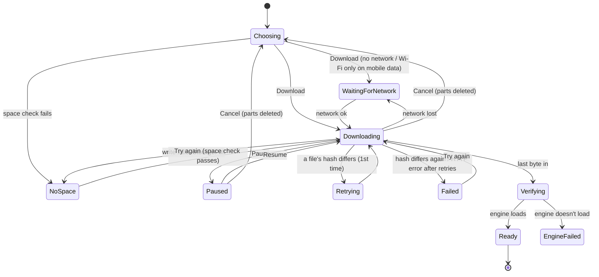

# 01 · First run and model download

Status: **spike** (the speed notes on the model cards and the default RTF per bundle come from the M1 results; everything
else is decided).

## 1. Goal

On the first start, explain Lectrice in one screen, let the user **pick the voice model** (Full quality fp32 ≈ 370 MB, or
Smaller int8 ≈ 126 MB; nothing pre-selected), download it safely (resumable, checked against hashes compiled into the app)
or import it from a file, and end with a playable voice sample. Reading works without the model ("Not now, just read").

## 2. User flow

1. App starts. If **no bundle is installed** and onboarding was never finished → **S1 Welcome**. Otherwise → Library.
2. S1: "Get the voice" → S2. "Not now, just read" → Library with the L5 banner; onboarding counts as finished.
3. **S2 Choose model:** two cards, none selected; the primary button reads "Choose a model" (disabled). Tapping a card selects
   it (S2s) and the button becomes "Download 370 MB" or "Download 126 MB". "Import from a file…" is always there.
4. Tap Download:
   1. If notification permission was never asked (API 33+) → the permission sheet (file 17, "download" variant), then the
      system dialog. The answer never blocks the download.
   2. Space check (§3.2). Not enough → S3 in state **S3d**, nothing starts.
   3. If the network is metered → **S2b** dialog: "Wait for Wi-Fi" (download waits for an unmetered network) or "Download
      now".
   4. The download starts → **S3**.
5. S3 shows progress, speed and time left. The user may **Pause** (S3a, "Resume"), **Cancel** (back to S2, the card stays
   selected), or "Meanwhile, open a PDF" (→ Library; the download continues, see §3.6).
6. When every file is in and checked, the engine loads → **S4 Ready**: the sample card ("Heart · American English"); tap
   play to hear the sample line. "Open a PDF" → the system file picker (file 03). "Go to library" → Library.
7. **Import from a file…** (S2): the system picker for a `.zip`; Lectrice checks it (§3.5); on success → S4; on failure →
   an error sheet, back to S2.
8. Later, from Settings → Voice model (file 11) or the export page's "Download · 126 MB" (file 10), the same download runs
   for the other bundle.

## 3. Rules & logic

### 3.1 The manifest

- Compiled into the app (`core:data/src/main/assets/model-manifest.json`), one entry per bundle:
  `bundleId` (`kokoro-en-v1_0-fp32`, `kokoro-en-v1_0-int8`), `variant` (`fp32` | `int8`, maps to core C11), display name,
  total bytes, `defaultRtf` (from the spike report, used until this phone has measured its own, file 10 §3.4), and per
  file: `name`, `url`, `bytes`, `sha256`.
- Files per bundle: `model.onnx`, `voices.bin`, `tokens.txt`, `lexicon-us-en.txt`, `lexicon-gb-en.txt`, `LICENSE`, `NOTICE`,
  and **only while the app uses sherpa-onnx 1.x** every file of `espeak-ng-data/` (spec §6.2, §14). Single files, no
  archive.
- URLs point at GitHub release assets of `kia-salvati/lectrice-android` (a dedicated release, e.g. tag `model-kokoro-v1.0`).
  The app **trusts only the hashes it ships with**; a URL may redirect (followed).

### 3.2 Space check

- Needed free space = **bundle bytes − bytes already downloaded + 200 MB** (to work with). Measured with
  `StorageManager.getAllocatableBytes(uuid of filesDir)`.
- Checked before starting, before resuming, and again if a write fails. Failure → `StorageFull` → S3d ("Not enough space.
  The voice needs 570 MB free (370 MB plus 200 MB to work with). Free up space and try again." with the real numbers).

### 3.3 Download state machine

| State | Screen | Copy (first brief §10.1 unless marked new) |
|---|---|---|
| Downloading | S3 | "Downloading the voice" · "142 MB of 370 MB · 38 %" · "2.1 MB/s · about 2 min left" |
| WaitingForNetwork | S3b | "Waiting for a network. The download continues on its own." · Wi-Fi only: **new** "Waiting for Wi-Fi. The download starts by itself when you connect." |
| Paused | S3a | "Paused · 142 MB of 370 MB" · primary "Resume" |
| Retrying | S3c | "Part of the download was damaged. Retrying…" |
| Failed | S3c | after a second hash mismatch: "Part of the download was damaged." + "Try again"; HTTP failure: **new** "The download failed. Try again." + "Try again" |
| NoSpace | S3d | §3.2 text |
| EngineFailed | S4 with an err banner | "The voice couldn't start. Try again, or download it again in Settings." + "Try again" (R9 copy) |
| Ready | S4 | "The voice is ready" |

### 3.4 How the bytes move

- `ModelDownloadWorker` (WorkManager, unique work name `model-download`, policy KEEP, foreground type `dataSync`, the N4
  notification). Constraint: `CONNECTED`, or `UNMETERED` when the user chose "Wait for Wi-Fi".
- Files are fetched **one at a time, in manifest order**, with `HttpURLConnection` (no OkHttp; spec §6.3), following
  redirects, timeouts 15 s connect / 30 s read.
- Each file is written to `filesDir/models/<bundleId>.download/<name>.part`. **Resume:** a `Range: bytes=<partSize>-`
  header. If the server answers `206`, append. If it answers `200` (Range ignored), truncate and start that file from 0.
- The SHA-256 is computed while streaming (`MessageDigest`); on resume, the existing `.part` is hashed first (it is read
  once from disk).
- After a file's last byte: compare size and hash to the manifest. Match → rename `.part` → final name in the same folder.
  Mismatch → delete it, **retry that file once** (Retrying); a second mismatch → Failed (`ModelChecksumMismatch`).
- Network errors → `Result.retry()` with exponential backoff starting at **30 s**, max **5 min**. HTTP 4xx/5xx (other than
  a transient 5xx, retried like a network error up to 3 times) → Failed (`ModelDownloadFailed`).
- Progress is published to the `ModelInstaller.state` flow at most every **250 ms**; speed = bytes over the last **5 s**;
  time left = remaining bytes ÷ speed, shown only after 3 s of data ("about 2 min left"; under a minute → "under a minute
  left").
- All files in → rename the folder `…download/` → `filesDir/models/<bundleId>/`, write `installed.json`
  (`{ bundleId, variant, installedAt, files: [{name, bytes, sha256}] }`) **last** (it is the "installed" marker). Then:
  - if no bundle is active, this one becomes active (DataStore `activeBundle`);
  - if it is the active one, call `reload_engine(Kokoro { model_dir, num_threads, provider, variant })` off the main thread;
    `engine_status()` must be `Ready`.

### 3.5 Import from a file

- System picker: `OpenDocument` with `application/zip` (and `application/octet-stream`, since some file managers report
  zips that way).
- Space check: zip size × 1.1 + 200 MB.
- Unzip with `java.util.zip.ZipInputStream` into `filesDir/models/import-<uuid>/`. Each entry's **base name** must be one
  of a manifest's file names (folders inside the zip are ignored, so a zip of the folder or of its files both work). Entries
  whose name contains `..` or starts with `/` are refused. Unknown files are skipped.
- Hash each entry while writing. The bundle is identified by the hash of `model.onnx`; every other file of that bundle must
  be present and match.
- Success → move to `filesDir/models/<bundleId>/`, `installed.json`, then as §3.4's last step. Failure → delete the folder
  and show a sheet: **new** "This file isn't a Lectrice voice model." / "Pick the .zip you downloaded for Lectrice." / "OK"
  (`ModelChecksumMismatch`), or the S3d text (`StorageFull`), or "This file couldn't be opened." (`FileUnreadable`).
- Import is refused while a download runs (the button is disabled, `fg2`).

### 3.6 Leaving the screen

- The download runs in the worker, so leaving S3 changes nothing. Library then shows, instead of L5, a **progress banner**
  (new): "Downloading the voice · 38 %" with a 4 dp bar and the text button "Details" (→ S3).
- When it finishes while the user is elsewhere: the N4 notification becomes **new** "The voice is ready" (tap → app), the
  banner disappears, the pill's "Voice not installed" state changes to normal.

### 3.7 The sample on S4

- Play → `speak_voice_sample("af_heart")` (core C16). The first call loads the engine (spinner on the play button, then the
  clip plays through a small non-session `AudioTrack`/ExoPlayer instance; it is not a MediaSession item).
- Shows "Heart · American English" and the sample line in Noto Serif italic: "This is how I sound when I read your books
  aloud." (the one fixed sample sentence for every voice and model, core C16).
- The sample is made on demand and then kept on disk (`cacheDir/lectrice/samples/`, C16), so this first play also makes
  the default voice's sample ready for later. No other voice's sample is made after the download (file 16 §3.2 has why).

### 3.8 The card notes

- Mockup copy now: card 1 "Quality: best · Speed on this phone: measured after setup"; card 2 "Quality: good · Usually
  slower on phones".
- **After M1** the second lines are rewritten from the spike's numbers (spike plan §6 "Model choice notes"), e.g.
  "Real-time on recent phones" / "A little slower than real time". The app never picks for the user.

## 4. States

| State | What the user sees |
|---|---|
| Empty (no network at all) | S2 works; Download → S3b waiting banner |
| Loading | S3 progress; S4 sample spinner while the engine loads |
| Error | S3c, S3d, EngineFailed (above); import error sheet |
| Offline | Same as WaitingForNetwork; import from a file works offline |
| Slow phone | The engine load on S4 may take up to 8 s (spike amber); the play button shows the spinner meanwhile |

## 5. Edge cases

- **App killed / phone restarted mid-download:** WorkManager re-runs the worker; `.part` files resume.
- **User clears the app's cache:** models live in `filesDir`, untouched. "Clear storage" removes everything (fresh first run).
- **The user picks the other card after a partial download:** each bundle has its own `.download` folder; the old partial
  folder is kept until Cancel or until that bundle is installed (then deleted). Only one download runs at a time.
- **Both bundles installed:** onboarding never shows again; Settings decides which is active (file 11).
- **A bundle folder exists without `installed.json`** (crash during the final rename): treated as not installed; deleted at
  the next app start.
- **Captive portal / HTML page instead of the file:** the size or hash fails → Retrying → Failed.
- **Low battery saver:** WorkManager may delay; the S3b banner covers it (it's "waiting").
- **Engine loads but `default_voice` is missing from the int8 bundle** (C12 UNVERIFIED): `assemble` fails with
  `VoiceUnknown` → EngineFailed; logged. The spike checks the voice ids first.

## 6. Where it lives

| Piece | Module | Notes |
|---|---|---|
| `ModelSetupScreen` (S1–S4) + `ModelSetupViewModel` | `feature:settings` | spec §4.1 |
| `ModelInstaller` interface (`state: StateFlow<InstallState>`, `download(bundle, wifiOnly)`, `pause()`, `resume()`, `cancel()`, `importZip(uri)`, `installed()`, `delete(bundle)`) | `core:model` | |
| `HttpModelInstaller`, `ZipModelImporter`, `ModelManifest` | `core:data` | the only code that touches the network |
| `ModelDownloadWorker` | `core:export` | foreground `dataSync` |
| Engine load | Rust via ffi `reload_engine`, `engine_status` | existing in the spec |
| Sample | ffi `speak_voice_sample` | **new, core C16** |
| Bundle → engine id | `KokoroSettings.variant` | **new, core C11** |
| Model dir without `espeak-ng-data` | `kokoro.rs` | **conditional C6b** (only if the app moves to sherpa-onnx 2.x) |

## 7. Data and persistence

| What | Where |
|---|---|
| Installed models | `filesDir/models/<bundleId>/` + `installed.json` |
| Partial downloads | `filesDir/models/<bundleId>.download/*.part` |
| `onboardingDone`, `activeBundle`, `pendingDownload { bundleId, wifiOnly, paused }`, `notificationAsked` | DataStore |
| Auto Backup | models and partial downloads are **excluded** (`dataExtractionRules`) |

## 8. Decisions and open questions

| Decision | By | When |
|---|---|---|
| The user picks fp32 or int8; nothing pre-selected; "Not sure? Pick Full quality." | user | 2026-10-23 |
| "Not now, just read" stays | approved design (S1) | 2026-10-23 |
| Single files + a compiled-in hash manifest, hosted on GitHub Releases | spec §6.2 | 2026-10-23 |
| Metered network warns, doesn't block | spec §6.3 | 2026-10-23 |
| One retry per damaged file, then "Try again" | Opus | 2026-10-24 |
| Download progress banner in the Library while it runs elsewhere | Opus (new copy) | 2026-10-24 |
| Wi-Fi-only waiting text | Opus (new copy) | 2026-10-24 |

Open (depends on the spike): the card notes' final wording; `defaultRtf` per bundle; whether `espeak-ng-data` is part of
the bundle (sherpa 1.13.8) or not (2.0).

## 9. Done when

- [ ] A first start shows S1; "Not now, just read" reaches the Library with L5 and never shows S1 again.
- [ ] S2's button stays disabled until a card is picked; the button text shows the picked size.
- [ ] On mobile data S2b appears; "Wait for Wi-Fi" waits (S3b Wi-Fi text) and starts by itself on Wi-Fi.
- [ ] **Airplane mode mid-download, then off:** the download continues from where it stopped (spec M4 line), checked by
      byte counts in the log.
- [ ] Killing the app mid-download and reopening shows S3 still progressing.
- [ ] A corrupted `.part` (test hook flips a byte) triggers one retry; flipping it twice shows "Try again".
- [ ] With less free space than needed, S3d shows the real numbers and nothing is downloaded.
- [ ] Import of a correct zip works offline and ends on S4; a wrong zip shows the import error sheet.
- [ ] S4's sample plays; `engine_status()` is `Ready`; the pill no longer says "Voice not installed".
- [ ] No URL, file name or hash mismatch detail beyond names/counts in release logs.

## 10. Design screens

S1, S2, S2s, S2b, S3, S3a, S3b, S3c, S3d, S4, L5, N4.
