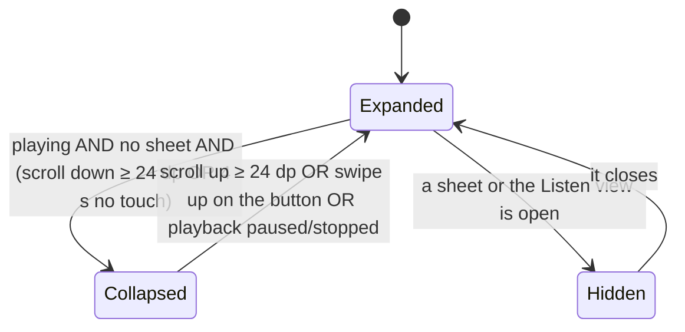
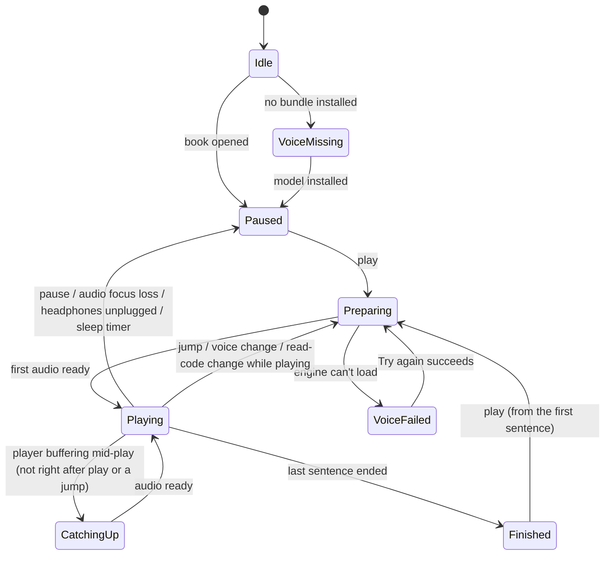

# 05 · Player pill and player sheet

Status: **decided**.

## 1. Goal

Control listening without leaving the text: a floating **pill** at the bottom of the reader (previous · play/pause · next ·
status · ⋯) that shrinks to a single round play button while you read, takes a few well-separated gestures, and grows into
the **player sheet** (speed, voice, sleep, chapters, export, library) or, by tapping its status, into the **Listen view**
(file 06).

## 2. User flow

1. In the reader, the expanded pill sits at the bottom. Tap ⏯ to play/pause, ⏮ ⏭ for the previous/next sentence.
2. Tap the **status** ("Ch. 7 · p. 265 ⤢") → the Listen view opens (container transform from the pill).
3. Tap **⋯** (or drag the pill up) → the player sheet opens at its half height; drag it to full or down to close.
4. **Long-press ⏯** → the speed scrubber pops up; slide to a speed, release to apply.
5. **Swipe the pill sideways** → next (finger moves left) / previous (finger moves right) sentence.
6. While playing, scrolling the text down (or 4 s without touching) **collapses** the pill to a round play button with a
   thin progress line; scrolling up or swiping up on the button expands it again.
7. In the player sheet: section jumps, a book slider, the **Chapters** button, speed, voice, sleep timer, "Read code &
   tables aloud", "Export audiobook" (pushes the export page, file 10) and "Library".
8. The first time the pill shows while playing, a one-time hint explains the gestures (R1h).

## 3. Rules & logic

### 3.1 Expanded pill geometry (Quiet)

- Absolute, left 12, right 12, bottom 12 + gesture inset; height **56**; radius full; `bg2`; 1 dp `line`; padding 0 8.
- Items left to right: ⏮ icon button 48 ("Previous sentence") · ⏯ 48 touch / 40 visible `accent` circle with `onAccent`
  icon ("Play"/"Pause") · ⏭ 48 ("Next sentence") · **status** (flex 1, min width 0, height 48, radius 12, one line,
  trailing `open_in_full` 16 `fg2`) · ⋯ 48 (`more_horiz`, "Player and settings").
- The pill is under the sheet's scrim when a sheet is open (the sheet's own transport row takes over).

### 3.2 Status text (one line)

Parts are joined with " · "; **fixed parts never shrink**; only a chapter name without a number gets an ellipsis.

| Situation | Text | Tap does | TalkBack label |
|---|---|---|---|
| Normal (playing or paused) | `Ch. 7 · p. 265` | Listen view | "Chapter 7, page 265. Open the Listen view" |
| …with speed ≠ 1× and screen ≥ 400 dp | `Ch. 7 · p. 265 · 1.5×` | Listen view | "… at 1.5 times speed …" |
| …with the sleep timer on | append `· ☾ 28 min` (moon icon 16 + minutes left) | Listen view | "… sleep timer 28 minutes …" |
| Chapter without a number | `Preface · p. xi` (the title, ellipsis) | Listen view | "Preface, page xi …" |
| No TOC | `p. 12 of 18` | Listen view | "Page 12 of 18 …" |
| Before the first TOC entry | `p. iii` | Listen view | "Page iii …" |
| Preparing (waiting for the first audio) | spinner 16 + `Preparing audio…` | Listen view | "Preparing audio" |
| Catching up (audio ran out mid-play) | spinner 16 + `Catching up…` | Listen view | "Catching up" |
| Finished | `Finished · play to start over` | Listen view | "Finished. Play to start over" |
| No model | `Voice not installed` (`accent`) | **S2 Choose model** | "Voice not installed. Tap to download" |
| Engine failed | `Voice unavailable` | **shows the R9 banner** (re-shows it if dismissed) | "Voice unavailable. Tap for details" |

- Width rules: below 400 dp the speed part is dropped (it stays in the sheet and the Listen view); if the sleep part still
  doesn't fit, only the moon icon stays. The `open_in_full` icon is dropped below 400 dp.
- **Below 360 dp** the status shrinks to just its `open_in_full` icon button (48), so the Listen view stays reachable
  (spec said "hide"; changed, README Changes #6).
- Live region: announces only when the chapter or page changes, or the state changes (preparing, catching up, finished).

### 3.3 Pill states and the collapsed button

- **Collapsed:** a 56 dp round button (`bg2` + 1 dp `line`, `accent` play/pause icon) at right 16, bottom 12 + gesture
  inset, plus a **2 dp progress line** (`accent` on `line`, book percent) across the bottom just above the gesture handle.
  Tap = play/pause (its only job). Long-press = speed scrubber. Swipe up = expand. TalkBack: "Pause" / "Play", custom
  action "Show the player".
- The morph between the two (R1t) is a 320 ms spring of position and size; instant under reduced motion.
- Pausing always expands the pill (paused = the user is probably about to do something).

### 3.4 Gestures on the pill (thresholds: README §4.1)

| Gesture | Target | Result |
|---|---|---|
| Tap ⏮ / ⏯ / ⏭ | expanded | previous sentence / play-pause / next sentence |
| Tap status | expanded | per §3.2 |
| Tap ⋯ | expanded | player sheet at half height |
| Drag up (start anywhere on the pill except during a long-press) | expanded | the sheet follows the finger from the pill's top edge; release → nearest detent, a fling goes one detent further; released below 30 % of the half height → closes |
| Horizontal swipe ≥ 48 dp | expanded (anywhere) | next (left) / previous (right) sentence; the status text nudges 120 ms in the swipe direction |
| Long-press ⏯ 500 ms | expanded or collapsed | speed scrubber (§3.5) |
| Swipe up | collapsed | expand |

**Previous and next are strict:** ⏮ always goes to the previous sentence in playback order (it never "restarts the current
one"); ⏭ to the next. At the first sentence ⏮ restarts it; at the last, ⏭ does nothing (a short haptic `REJECT`).
The same rule holds on the lock screen and headset (file 09).

### 3.5 Speed scrubber

- Pops 8 dp above the ⏯ button: a vertical stack of 6 chips, **2× at the top … 0.75× at the bottom**, the current one
  selected (`accentContainer`). The finger stays down from the long-press.
- Sliding over a chip highlights it (haptic `SEGMENT_TICK` on each change). **Releasing** on a chip applies it. Releasing
  away from every chip applies the last highlighted chip; if none was highlighted, nothing changes.
- Back or a tap outside closes it without a change. TalkBack users use the sheet's Speed control instead (custom action
  "Change speed" on the pill opens the sheet scrolled to Speed).
- Speed applies at once (file 16).

### 3.6 The player sheet (R4, Quiet single page)

- Modal bottom sheet: `bg2`, top radius 28, handle 32 × 4 in a 48 dp handle area, scrim behind. **Half detent** =
  `min(600 dp, 70 % of the screen height)`; **full** = top at status inset + 16. Opens at half. Drag follows the finger
  (`AnchoredDraggable`), detents as in README §4.1.
- Content, top to bottom:
  1. **Transport row**: ≪ section 48 ("Previous section") · ⏮ 48 · ⏯ 64 touch / 56 visible · ⏭ 48 · ≫ section 48 ("Next
     section"). Section rules: file 07 §3.5. Long-press ⏯ → speed scrubber here too.
  2. **Book slider** (16 below): track 4 dp `line`, active `accent` (book percent), **buffered** part `accentContainer` from
     the thumb to `readyAheadMs` ahead (core C25; absent if 0), thumb 20 dp. **Chapter ticks** 2 × 8 dp `fg2` at the start of
     every chapter-like entry (file 07 `isChapterNode`), only if there are ≤ 60 of them. Under it: "Ch. 7 · 49 %" left,
     "4 h 12 min left" right (`caption` `fg2`).
     - Dragging the thumb shows a bubble above it: "p. {label} · Ch. {n}" for the target. Release → jump to the first
       playable sentence with id ≥ `round(fraction × (sentenceCount − 1))`; play/pause kept; follow-scroll on.
     - TalkBack: a slider "Book position, 49 percent"; volume-style steps of 1 % jump to that place.
  3. **Chapter line** (16 below): a full-width button (min height 56): line 1 `label` 16 500 "7. Long Documents › 7.3 Tables of
     contents that tell the truth" (2 lines max), line 2 `body-s` `fg2` "38 % of this chapter · 9 min left in it · Page 265 · PDF
     page 279 of 589", trailing **`toc` icon + "Chapters"** (`label` `accent`). Tap → the chapters outline (file 07).
     No TOC: line 1 "Page 12 of 18 · PDF page 12", trailing "Chapters" still opens the outline (which shows R8c).
  4. **Speed** header + Quiet's segmented control with the six speeds (height 40).
  5. Rows (48–56, divider 1 dp `line`):
     - `record_voice_over` **Voice** / "Heart · US · female" ⌄ → expands inline: 6 rows (the current voice first, then the
       5 other voices of its group) + text button "All 28 voices" (expands to all, grouped). Each row has a 48 `volume_up`
       sample button. File 16.
     - `bedtime` **Sleep timer** / "Off" or "Stops at 23:41" ⌄ → inline chips. File 15.
     - `menu_book` **Read code & tables aloud** + switch. Same value as Settings (global).
     - `download` **Export audiobook** / "Pick the voice, quality and speed" › → pushes the export page (file 10). While an
       export of this book runs: "Exporting · 42 %" + a 4 dp bar (120 wide) (R4x).
     - `menu_book` **Library** › → closes the sheet and goes to the Library (playback continues).
- **Pushed page** (export): slides in from the right (320 ms), the sheet goes to full; its back arrow or system back pops it.
- Back closes the pushed page first, then the sheet. Closing returns focus to ⋯.

### 3.7 One-time hint (R1h)

- Shown **once ever**: the first time the expanded pill has been visible for 3 s while playing.
- An `inverseBg` tooltip above the pill: "Tap here for the Listen view. Drag up for more. Long-press play for speed." +
  "Got it". It also counts as seen when the user uses any of those three gestures first.
- Never shown to TalkBack users (they get the custom actions); DataStore `hint.pill = true`.

### 3.8 Playback state (what the pill renders)

`PlaybackState` (from `PlaybackController.state`): `documentId`, `currentSentenceId`, `status`, `speed`, `voiceId`,
`readSkipped`, `sleep` (file 15), `readyAheadMs`, `error: ErrorName?`.

`Preparing` covers the engine load on the first play (up to 3–8 s on slow phones) plus the first sentence.

## 4. States

| State | Pill | Sheet |
|---|---|---|
| Loading the book | disabled (40 % `line` icons, no actions) | can't open |
| Preparing | spinner status; the ⏯ circle becomes `accentContainer` with an `onAccentContainer` pause icon and a 2 dp `accent` ring spinning (R3) | same in its transport |
| Error | "Voice unavailable" / "Voice not installed" | transport disabled; speed/voice/sleep still editable; export row disabled with "Needs the voice" (**new**) |
| Offline | no difference | no difference |
| Slow phone | "Catching up…"; the slow-phone tip (file 12) | — |
| 200 % font | pill 72 dp, status one line with ellipsis (R12) | rows grow; the sheet scrolls inside |

## 5. Edge cases

- **Tap vs swipe vs drag on the status area:** decided by movement and time (README §4.1); a gesture that moved > 8 dp is
  never a tap, so a sideways swipe on the status never opens the Listen view.
- **Long-press then drag up:** once the scrubber is open, vertical motion moves through the chips, never the sheet.
- **Collapsed while a snackbar shows:** the snackbar sits 12 above the collapsed button.
- **The sheet open when playback finishes:** status rows update; the sheet stays.
- **Voice changed in the sheet while paused:** only the next play uses it; nothing synthesizes until then.
- **Rotation with the sheet open:** stays open at the same detent (`rememberSaveable`).
- **Export page open, export finishes:** the page changes from E2 to E4 in place.
- **No TOC:** section buttons are disabled (`line` icons, `aria-disabled`, TalkBack "Previous section, unavailable").

## 6. Where it lives

| Piece | Module |
|---|---|
| `PillPlayer` (expanded/collapsed/morph), `SpeedScrubber`, `HintTooltip`, `SheetScaffold`, `SegmentedControl`, `BookSlider` | `core:designsystem` |
| `PlayerSheet` (content), `ReaderViewModel` actions (`play`, `pause`, `next`, `previous`, `jumpTo`, `setSpeed`, `setVoice`, `setReadSkipped`, `nextSection`, `previousSection`) | `feature:reader` |
| `PlaybackController` interface | `core:model`; implemented by `MediaControllerPlaybackController` in `core:playback` |
| Pure helpers: `playerStatusParts` (port of `frontend/src/utils/playerStatus.ts`), `timeLeft`, `tocLocation`, `chapterLabel` | `core:model` |
| Core | `playback_order`, `speak_sentence` (via the DataSource, file 09); **new** C25 `ready_ahead_ms` |

## 7. Data and persistence

- DataStore: `hint.pill`, per-book `speed` and `voice` (file 16), global `readSkipped`.
- View state (`rememberSaveable`): sheet open + detent, pushed page, voice list expanded, sleep row expanded, pill
  collapsed.

## 8. Decisions and open questions

| Decision | By | When |
|---|---|---|
| Quiet pill: collapse while reading, drag-up sheet, long-press speed, swipe ± sentence | user (approved v2) | 2026-10-23 |
| Status tap opens the Listen view; ⋯ stays the player sheet; chapters two taps away (README §4.2) | design + Opus (best practice) | 2026-10-23 / 24 |
| The chapter line gets a visible `toc` icon + "Chapters" label (the mockup's line has no icon) | Opus, part of the chapters decision | 2026-10-24 |
| Below 360 dp the status becomes an icon button instead of hiding | Opus | 2026-10-24 |
| Strict previous/next sentence everywhere (no "restart current") | Opus | 2026-10-24 |
| Pausing expands the pill | Opus | 2026-10-24 |
| Slider is draggable (seek in the book) with a page/chapter bubble | Opus | 2026-10-24 |
| Export row says "Pick the voice, quality and speed" (the mockup's "…, format and…" dropped with MP3) | user (M4B only) | 2026-10-23 |

## 9. Done when

- [ ] Every row of §3.4 works on both test phones; a swipe or drag never also fires a tap (instrumented gesture tests).
- [ ] The status text matches §3.2 for each situation at 412, 360 and 340 dp widths.
- [ ] Collapse/expand follows §3.3 and never happens while paused.
- [ ] Scrubber: release on 1.5× sets 1.5× (status shows it at ≥ 400 dp); release outside after hovering 1.25× sets 1.25×.
- [ ] The sheet's half detent shows the transport, slider, chapter line and speed without scrolling on a 412 × 915 phone.
- [ ] Slider drag shows the bubble and jumps on release.
- [ ] R1h shows once and never again (also after a restart).
- [ ] TalkBack can do everything without gestures (custom actions + buttons).

## 10. Design screens

R1, R1c, R1t, R1h, R1s, R3, R4, R4x, R5, R6, R12.
