# 10 · Export the whole book (M4B)

Status: **decided** (needs core C10, C12, C18, C19, C24, C30; C23 proposed). How well common players read our chapter
marks is an M4 test. The "not enough space" and partial-export screens (E6, E7) are new and need a design pass (§10).

## 1. Goal

Turn a whole book into **one M4B audiobook file with chapter marks**, in the background, surviving Android's limits on
long jobs, so the user can listen in any audiobook app. The user picks the **voice**, the **model quality** (Full fp32 /
Smaller int8), the **speed** (baked into the file, same pitch) and whether code and tables are read. **M4B only** (no MP3:
license, user 2026-10-23).

## 2. User flow

1. Player sheet → **Export audiobook** ("Pick the voice, quality and speed") → the export page slides in (E1), the sheet goes
   full height.
2. E1 shows four groups and a pinned footer with a live estimate:
   - **Voice** (this book's voice; tap to expand the list with samples),
   - **Quality** ("Full quality" / "Smaller"; a model that isn't installed shows "Download · 126 MB"),
   - **Speed** (0.75×–2×, default 1×, with a note),
   - **Read code & tables aloud** switch,
   - the reassurance card, and the footer: "about 8 h 10 min · about 231 MB" / "Takes about 2 h on this phone" /
     **Start export (about 2 h)**.
   - **If the phone hasn't room for it** (§3.11): the footer turns into the E6 "not enough space" state: needed vs free, and
     two ways on: **Free up space** (→ Settings → Storage, file 20) or **Export part of the book** (→ E7, chapters that fit,
     the fitting range already picked).
3. Start → E2: "Exporting · 42 %", "Part 21 of 49 · about 1 h 10 min left", "Listening comes first: the export slows down
   while you listen.", **Pause**, **Cancel export**. A notification (N3) shows progress with Pause / Cancel. The user can
   leave the page, the book or the app.
4. If Android stops the job (daily limit), E3: "Paused by Android…" + **Continue now**; it also continues by itself while
   charging or when the app is opened.
5. Out of space mid-export (another app filled the phone) → the export **pauses and keeps its finished parts** → E5
   ("…21 of 49 parts are kept, so nothing is lost…") + **Continue** / **Free up space** / **Cancel export**. It also continues
   by itself once there's room again (§3.12).
6. Done → E4 "Audiobook ready" · "8 h 10 min · 231 MB · M4B" · **Save to Audiobooks** ("Audiobook players will find it
   there"; moves the file, file 20 §3.4) · **Save as…** · **Share** · **new** "Make another version".

## 3. Rules & logic

### 3.1 Which state the page shows

The page shows **this document's latest export** (`list_exports(docId)`, newest first):

| Record | Page | Main copy (first brief §10.1 / v2 brief §4, else **new**) |
|---|---|---|
| none, or the latest is `cancelled` | **E1** | — |
| `queued`, another export (other book) running | E2 "waiting" | **new** "Waiting for another export to finish." (no bar movement) |
| `queued` with `waiting_for_engine`, or `paused` by `EngineSwitch` | E2 "waiting" | "This export uses the smaller model. While you listen, it waits and continues when you stop." (or **new** "…uses the full-quality model…") |
| `running` | **E2** | "Exporting · 42 %" / "Part 21 of 49 · about 1 h 10 min left" / "Listening comes first: the export slows down while you listen." |
| `paused` by `System` | **E3** | "Paused by Android. Long background jobs have a daily time limit. It continues while charging, or when you open Lectrice." · "Continue now" · "Samsung phones may stop it sooner: allow unrestricted battery" |
| `paused` by `User` | E2 "paused" | **new** "Paused · 42 %" · primary "Continue" · "Cancel export" |
| `paused` by `StorageFull`, stage `Parts` | **E5** | "The export stopped: the phone ran out of space. 21 of 49 parts are kept, so nothing is lost. Free up space and continue." + **new** line `body-s` "Needs about {needed} free · {free} free now" · "Continue" (disabled while free < needed) · text "Free up space" · "Cancel export" |
| `paused` by `StorageFull`, stage `Assemble` | **E5b** | **new** "All 49 parts are made, but there isn't room to put them together. Free up about {needed − free} and continue." + the same needed/free line and buttons |
| `paused` by `System` for heat or battery (§3.7) | E3 variant | **new** "Paused while the phone is hot. It continues when it cools down." / **new** "Paused to save battery. It continues while charging." · "Continue now" |
| `failed` | E5 style (err banner) | **new** "The export stopped and can't continue. Start it again." · primary "Start again" (→ E1 with the same choices) |
| `done` | **E4** | "Audiobook ready" · "8 h 10 min · 231 MB · M4B" |

- Under the page header of E2–E5 a summary line: "Heart · Full quality · 1×" (voice name · quality · speed).
- **One unfinished export per document** (a UI rule): while one is unfinished, E1 isn't reachable for that book (cancel
  first). Exports of different books queue, oldest first.

### 3.2 E1 choices

| Group | Options | Default | Rules |
|---|---|---|---|
| Voice | the 28 voices (file 16) | this book's current voice | row: `record_voice_over` · "Heart" / "American English · female" · ⌄; expands to 6 rows + "All 28 voices", each with a sample button |
| Quality | **Full quality**, **Smaller** | the bundle in use | subtitle: "In use · 370 MB", "Installed · 126 MB" or "Not downloaded" (radio disabled + text button "Download · 126 MB", which runs the file 01 download inline: "Downloading · 38 %" + 4 dp bar; when done the row becomes selectable, not auto-selected) |
| Quality note | shown when the picked bundle isn't the one in use | — | "This export uses the smaller model. While you listen, it waits and continues when you stop." / **new** "This export uses the full-quality model. While you listen, it waits and continues when you stop." (20 dp `info` icon, `body-s` `fg2`) |
| Speed | 0.75×, 1×, 1.25×, 1.5×, 1.75×, 2× (segmented) | **1×** (not the listening speed) | note at 1×: "Normal speed. Your audiobook app can still change it."; other: "Baked into the file: it plays at 1.5× everywhere, at the same pitch." |
| Read code & tables aloud | switch | the global setting | affects only this export |

There is **no Format control** (M4B only). The mockup's Format group, its "Spec change" badge and MP3 notes are dropped.

### 3.3 Start checks (in order)

1. A bundle is installed and the picked one is installed (else the Start button is disabled with the row's "Download").
2. **Space** (§3.11): computed live with the estimate, so the footer already shows E6 before the user taps. On tap it is
   checked once more (free space may have changed); if it no longer fits, the page switches to E6 instead of starting.
3. Notification permission asked if never asked (file 17); never blocking.
4. `start_export(docId, voiceId, variant, speedPercent, readSkipped, range)` (core C10, C12, C30; `range = None` for the
   whole book). The core refuses an unknown voice (`VoiceUnknown`) or a missing document.
5. Enqueue the `ExportWorker` (§3.7). Page → E2 (or E2 "waiting").

### 3.4 The estimate (footer)

- Inputs: `estimate_export(docId, voiceId, variant, readSkipped, speedPercent)` (core C18) → `audio_ms_1x`, `output_ms`,
  `cached_ms_1x`.
- **Length** = `output_ms` → "about 8 h 10 min" (minutes rounded; ≥ 1 h as "h + min").
- **Size** = `output_s × 8 000 bytes/s` (64 kbit/s) → "about 231 MB" (≥ 1000 MB: "about 1.2 GB").
- **Time to make** = `(audio_ms_1x − cached_ms_1x) × RTF(bundle)`, where RTF(bundle) is, first available: the sustained
  `speech_stats().rtf_median` if that bundle is loaded and has ≥ 10 samples; the last value stored for that bundle on this
  phone (DataStore `rtf.<bundleId>`, saved whenever stats are read); the manifest's `defaultRtf` (from the spike).
  Rounded: < 5 min → "a few minutes"; < 1 h → nearest 5 min ("about 40 min"); ≥ 1 h → nearest 10 min, " 0 min" dropped
  ("about 2 h", "about 2 h 10 min").
- Footer copy: line 1 "about {length} · about {size}", line 2 "Takes {time} on this phone", button "Start export ({time})".
- Recomputed on every choice change (debounced 150 ms, off the main thread); the two lines cross-fade 120 ms (0 under
  reduced motion); one `polite` live region.
- Example values (the mockup's fake model, v2 brief §4.1): 1× ≈ 8 h 10 min / 231 MB; 1.5× ≈ 5 h 27 min / 154 MB; 2× ≈ 4 h 5 min
  / 116 MB; Full ≈ 2 h, Smaller ≈ 3 h to make.

### 3.5 Export state machine (core record + UI)

```mermaid
stateDiagram-v2
  [*] --> Queued: Start
  Queued --> Running: worker picks it (engine matches)
  Queued --> Queued: waiting (another export / other bundle loaded)
  Running --> Paused_User: Pause
  Running --> Paused_System: Android stops the worker
  Running --> Paused_StorageFull: StorageFull while writing a part
  Running --> Paused_EngineSwitch: listening needs the other bundle
  Running --> Paused_StorageFull: StorageFull while assembling (parts kept)
  Paused_System --> Queued: worker restarts (charging / app opened / cooled down / Continue now)
  Paused_EngineSwitch --> Queued: listening stops
  Paused_User --> Queued: Continue
  Paused_StorageFull --> Queued: Continue, or room again (StorageWaitWorker)
  Running --> Done: all parts + assemble
  Running --> Failed: any other error (final; parts deleted)
  Queued --> Cancelled: Cancel export
  Paused_User --> Cancelled
  Paused_System --> Cancelled
  Paused_StorageFull --> Cancelled
  Running --> Cancelled
  Done --> [*]
```

- **Cancel** asks first: **new** dialog "Cancel this export?" / "The parts made so far are deleted." / "Keep exporting" ·
  "Cancel export". Cancel deletes the parts (core).
- **Parts:** the core writes ~10 listening-minutes (at 1×) per part and records each finished part, so at most one part's
  work is lost on any stop (core C5, done in v1.1).

### 3.6 One engine, two bundles (core C12)

The core holds one engine. A Kotlin `EngineCoordinator` decides which bundle is loaded:

- **Listening is active** = playback is Playing / Preparing / Catching up, or paused for less than 60 s.
- While listening is active → the **listening bundle** (the active bundle from Settings) is loaded.
- When listening is not active and the oldest runnable export needs the **other** bundle → `unload_engine()`, then
  `reload_engine(other)`; the export runs.
- When the user presses play while the other bundle is loaded → the running export is paused (`EngineSwitch`, by the core
  when the services are rebuilt), `reload_engine(listening bundle)`, then play (the user sees "Preparing audio…" a few
  seconds longer). When listening stops (> 60 s paused), the export's bundle is loaded again and it resumes.
- Never two engines in memory.

### 3.7 Running in the background (spec §8.2–8.3)

- `ExportWorker : CoroutineWorker`, unique work `export`, policy KEEP.
  1. `setForeground(...)`, type **`mediaProcessing` on API 35+**, `dataSync` below; notification N3.
  2. `resume_exports()` (resumes `System` and `EngineSwitch` pauses, C24), then waits on `CoreListener` updates until no
     runnable unfinished job is left (queued jobs that wait for another bundle don't keep it running if listening is active;
     the coordinator restarts the worker when they become runnable).
  3. `onStopped` (incl. `STOP_REASON_FOREGROUND_SERVICE_TIMEOUT`, the Android 15+ 6-hours-per-24-h limit): call
     `pause_exports_for_system()` and return.
  4. After a timeout: re-enqueue as **regular (non-foreground) work** with constraints **charging** and **battery not low**;
     each such run works up to **9 minutes**, pauses (`System`) and re-enqueues itself.
  5. When the app comes to the foreground (the 6-hour budget resets then), a pending export is re-enqueued as foreground
     work at once.
- **Continue now** (E3) = enqueue the foreground worker now.
- Priority: export jobs are priority 3 on the speech worker; listening always comes first (E2's note).
- Samsung battery optimisation may stop it sooner (UNVERIFIED per device): E3's text button opens the system page
  (file 17).
- **Heat and battery** (the governor's rules 5 and 7, file 08 §3.3): thermal status CRITICAL or higher → the worker calls
  `pause_exports_for_system()` and waits until the status is ≤ MODERATE for 2 min, then resumes; battery saver on, or battery
  ≤ 15 % while not charging → pause the same way; it continues on charging (the re-enqueued work has the constraints
  charging + battery not low). The record's `paused_by` is `System`; Kotlin keeps the cause (`heat` | `battery`) in the
  worker's progress data so E3 can show the right line.

### 3.8 Encoding (Kotlin side of the exporter port; spec §8.4)

- `AacEncoderSink` implements the ffi `AudioEncoderSink`: `MediaCodec` **AAC-LC, mono, 24 kHz, 64 kbit/s**, one `.m4a` per
  part via `MediaMuxer`, written to `…/parts/<exportId>/part-NNNN.m4a.partial` and renamed on `finish_part` (which returns
  the sample count).
- `assemble`: remux every part into one `.m4b` (`MediaExtractor` → `MediaMuxer`, no re-encoding, timestamps offset by the
  previous parts' durations), then a small post-step writes the chapter marks as a **Nero `chpl` box** (plus a QuickTime
  chapter text track if the M4 player test shows it's needed), the title (book title) and artist (from the core target),
  and (proposed) the cover tile as `covr`.
- Chapter marks come from the core (`ChapterMark { title, start_ms }`, already divided by the speed, C10); proposed C23 takes
  them from the TOC (levels ≤ 2).
- The finished file: `filesDir/lectrice/exports/<docId>/<file name per C10, C30>.m4b` (app storage; counted under
  Lectrice in Android's Settings, file 20 §3.1). Parts are deleted by the core after done, failed or cancel, **never after a
  `StorageFull` pause** (C24).

### 3.9 Saving and sharing (E4)

- **Save to Audiobooks** = a **move** (file 20 §3.4): first `getAllocatableBytes ≥ file size + 50 MB` (else the
  `StorageFull` snackbar with "Free up space"), then MediaStore insert with `RELATIVE_PATH = Audiobooks/Lectrice/` (API 29+),
  `IS_PENDING = 1` while copying, then 0; MIME `audio/mp4`; display name `{Title} - {Voice}.m4b`, or
  `{Title} - {Voice} - 1.5x.m4b` when the speed isn't 1×, plus ` - Ch. 7–12` for a partial export (§3.11), with
  `/\:*?"<>|` and control characters removed, cut at 120 chars. A duplicate name is renamed by MediaStore. Then the private
  file is deleted and `mark_export_saved(id, uri)` (C19) stores the new place. Success → snackbar **new** "Saved to
  Audiobooks/Lectrice." and the E4 button becomes **new** "Saved to Audiobooks" (disabled). A failed copy deletes the pending
  item; the private file stays.
- **Save as…:** SAF `CreateDocument("audio/mp4")` with the same suggested name; streamed copy; the file in Lectrice stays.
- **Share:** `ACTION_SEND`, type `audio/mp4`, a `FileProvider` URI (in Lectrice) or the MediaStore URI (in Audiobooks), with
  `FLAG_GRANT_READ_URI_PERMISSION`.
- Settings → Storage lists, opens, shares and deletes exports in both places (C19, file 20 §3.5).
- **Make another version** → E1 with the previous choices pre-filled (the done export stays listed).

### 3.10 Notifications

| When | Text | Actions |
|---|---|---|
| Running | "Exporting The Long Book · 42 %" / "Heart · 1× · M4B" + progress bar | Pause, Cancel |
| Waiting | **new** "Export waiting · The Long Book" / "Continues when you stop listening." (or "…when the other export is done.") | Cancel |
| Paused by Android | **new** "Export paused · The Long Book" / "It continues while charging or when you open Lectrice." | Continue |
| Out of space | **new** "Export paused · The Long Book" / "The phone ran out of space. It continues when there's room." | **new** "Free up space" (→ Settings → Storage) |
| Paused for heat / battery | **new** "Export paused · The Long Book" / "The phone is hot. It continues when it cools down." or "Saving battery. It continues while charging." | Continue |
| Done | **new** "Audiobook ready · The Long Book" / "8 h 10 min · 231 MB" | tap → the reader with the export page |
| Failed | **new** "The export stopped · The Long Book" | tap → the export page |

The notification channel "Exports" (default importance low; done/failed use "Export results", default importance). Android
16 Live Updates (a progress chip) are a later option (v2 brief §2), not v1.

### 3.11 Space: predict, check, and export part of the book (user 2026-10-24)

**Prediction** (pure Kotlin, `ExportSpaceCheck`, JVM-tested; inputs from `estimate_export`, C18 + C30):

| Symbol | Formula | Notes |
|---|---|---|
| `output_s` | `audio_ms_1x ÷ 1000 ÷ speed` (of the whole book or the picked range) | the book's 1× estimate is `chars ÷ 18` (README §4.7) |
| **F** (final file) | `output_s × 8 000 B/s × 1.03` | AAC-LC mono 64 kbit/s = 8 000 B/s; **+3 %** for the MP4 boxes, chapter box and part joins (`CONTAINER_OVERHEAD = 0.03`, UNVERIFIED, measured in M4 and adjusted) |
| **P** (temp parts) | ≈ F | on Android the parts are already AAC `.m4a` (not WAV); the only uncompressed audio is the sentence being encoded, in memory. The open `.partial` part (≤ ~5 MB) is inside P. Export clips are not written to the audio cache |
| **M** (safety margin) | `max(100 MB, 10 % × F)` | covers the ±10 % error of `chars ÷ 18` and leaves the phone usable |
| **needed** (new export) | `P + F + M = 2F + M` | the peak is during assemble: every part plus the final file, before the parts are deleted |
| needed (resume, stage Parts) | `(F − bytes of finished parts) + F + M` | Kotlin sums the part files' sizes |
| needed (resume, stage Assemble) | `F + M` | |
| **free** | `StorageManager.getAllocatableBytes(getUuidForPath(filesDir))` | includes cached files Android is willing to delete (ours and other apps') |

- Shown sizes stay README §4.7's `output_s × 8 000` ("about 231 MB"); the 3 % and the margin are only for the check.
- Example: 8 h 10 min at 1× → F ≈ 242 MB, M = 100 MB, needed ≈ 584 MB.
- **Fits** when `needed ≤ free`. When it fits only by clearing caches (`File.usableSpace < needed ≤ free`), Start first calls
  `StorageManager.allocateBytes(uuid, needed)`, which makes Android delete cached files now; an `IOException` there → E6.
- Recomputed with the estimate (debounced 150 ms) and again on Start.
- "Save to Audiobooks" needs another F later, while it copies; that is checked when the user taps it (§3.9), not here.

**E6 · Not enough space** (the E1 page, footer state; Quiet v2 style: a `warnBg` / `warnFg` card, radius 12, `info`-style
20 dp `sd_card_alert` icon, in place of the footer's line 2 and button):

- `body` 500 **new** "Not enough space for the whole book."
- `body-s` **new** "It needs about {needed} free. The phone has {free}."
- Primary **new** "Export part of the book" → E7 with the suggested range (hidden when no chapter fits, below).
- Secondary / text **new** "Free up space" → Settings → Storage (file 20), opened with `requestedBytes = needed − free`, which
  shows a banner at its top: **new** "Free up about {x} to export this book." + text button "Open phone storage"
  (`StorageManager.ACTION_MANAGE_STORAGE` with `EXTRA_REQUESTED_BYTES`). Coming back recomputes E1.
- Nothing fits (not even the suggested start chapter): only "Free up space", with **new** "There isn't room for even one
  chapter. Free up about {x} and try again."
- Line 1 of the footer (length · size of the whole book) stays, so the user sees what they asked for.

**E7 · Export part of the book** (a pushed page inside the sheet, like E1; back returns to E1 keeping the choices):

- Header "Export part of the book"; under it `body-s` `fg2` **new** "{free} free on this phone. The whole book needs about
  {needed}."
- Two rows (56 dp): **From** "7. Long Documents" ⌄ and **To** "12. Indexes" ⌄. Each opens the chapter list (a sheet) with
  one row per chapter: the chapter title (file 07 `isChapterNode` entries, top level; front matter before the first chapter
  is one row **new** "Beginning" when it has playable sentences) and its meta "about 42 min · about 20 MB". Picking a From
  after the To (or a To before the From) moves the other end to the same chapter. The range is **contiguous** (one file
  with continuous chapters).
- A book **without chapters** (R8c): the rows pick pages instead, in steps of the export plan's parts (each ~10
  listening-minutes, labelled by its first printed page: "p. 1", "p. 23", …).
- **Suggested range** (pre-filled): start = the chapter of the book's saved place (file 13), or the first chapter when the
  book isn't started or is finished; end = the furthest chapter from there such that `2 × Σ F(chapters) + M ≤ free`. If
  the start chapter alone doesn't fit, there is no suggestion (E6 shows "Free up space" only).
- Footer (the E1 footer): line 1 **new** "Chapters 7–12 · about 3 h 5 min · about 89 MB"; line 2 "Takes about 45 min on this
  phone"; button "Start export (about 45 min)". If the picked range doesn't fit: line 2 becomes **new** "Doesn't fit: needs
  about {needed}, {free} free" in `warnFg`, the button is disabled, and a text button **new** "Pick what fits" restores the
  suggestion.
- Start → `start_export(…, range = { from_sentence, to_sentence })` (C30); then E2 as usual. The summary line under the
  header gains "· Ch. 7–12" (or "· p. 23–118"); E4 reads "Chapters 7–12 · 3 h 5 min · 89 MB · M4B".
- The file: chapter marks only for the chapters inside the range, timed from the range start (C30); title metadata
  "{Title} (Ch. 7–12)"; MediaStore name gets " - Ch. 7–12".
- A partial export is its own target (C30's same-target rule includes the range). "One unfinished export per book" still
  holds. "Make another version" opens E1 for the whole book (range cleared).

### 3.12 Out of space during an export (C24; fixes the earlier contradiction)

The earlier text said E5 "keeps the parts" while the core's rule was "an error fails the job and deletes its parts", and
C24 only covered errors while writing a part. **Now, everywhere:** a `StorageFull` at **any** step (writing or finishing a
part, saving the record, assembling the final file, writing its chapter box) **pauses** the export with reason
`StorageFull` and **keeps every finished part**. Only the open `.partial` part is dropped (at most ~10 listening-minutes
of work redone); during assemble the half-written `.m4b` is deleted and the record's `stage` is `Assemble`. `Failed` (parts
deleted) is only for other errors.

Then:

1. The page shows E5 (stage Parts) or E5b (stage Assemble) with "Needs about {needed} free · {free} free now" (§3.11 resume
   formulas); the notification "Export paused · … ran out of space" with "Free up space".
2. Kotlin enqueues a one-time **`StorageWaitWorker`** (unique `export-storage-wait`): constraint
   `setRequiresStorageNotLow(true)` (how promptly WorkManager sees "storage not low" on API 26+ is UNVERIFIED, so it also has
   a 15 min initial delay and re-checks every 30 min). Each run: if `free ≥ needed` → `resume_export(id)` (C24) and enqueue
   the `ExportWorker`; else re-enqueue itself. It's cancelled by Continue, Cancel export, or the book's removal (file 21).
3. The same check runs when the app comes to the foreground, when the export page opens, and after every delete on the
   Storage screen (file 20), so freeing space in Lectrice continues the export at once.
4. **Continue** is enabled when `free ≥ needed`; tapping it when space ran out again in the meantime just pauses again with
   `StorageFull` (no parts lost).
5. Listening keeps working meanwhile: its cache is in `cacheDir`, which Android clears under pressure (file 20).

## 4. States

| State | Shown |
|---|---|
| Loading the page | the estimate shows "about …" placeholders for ≤ 300 ms, then numbers |
| Empty | n/a (always E1 or a record) |
| Error | E5 / E5b / failed (above); a refused start shows a sheet with the registry text |
| Not enough space before start | E6 (§3.11); E7 to export part of the book |
| Offline | no difference (only the inline model download needs the network) |
| Slow phone | the time estimate is higher; E2's "time left" uses the core's measured rate |
| No voice model at all | the player sheet's export row is disabled: **new** "Needs the voice" |

## 5. Edge cases

- **8-hour book on Android 15+:** crosses the 6-hour foreground limit → E3 → continues while charging / on the next app open,
  from the next part. (Spec M4 line.)
- **Phone restarted mid-export:** WorkManager re-runs the worker after boot; the core loads the job as paused (System) →
  `resume_exports` continues it.
- **Book re-cleaned (cleaner version bump) while an export is paused:** the core fails it (the plan changed) → failed copy.
- **Bundle deleted:** blocked by the model page while an unfinished export uses it (file 11).
- **Listening to the same book during its export:** both work; clips made for listening are reused by the export if they
  match (same voice + engine), and vice versa (export clips are not cached; listening clips are).
- **Two exports of different books:** FIFO; the second shows "Waiting for another export to finish."
- **Cancel during assemble:** the core cancels after the current step; the target file is removed.
- **MediaStore save fails** (full disk): the pending item is deleted; snackbar with the `StorageFull` text + "Free up
  space"; the file in Lectrice is untouched.
- **Space frees up while E6 is showing** (the user deleted something in another app): E1 recomputes on resume and on every
  choice change; the footer goes back to "Start export".
- **The suggested range is the rest of the book** (it all fits from the current chapter): E7 still opens, pre-filled; the
  user may pick earlier chapters, which may not fit.
- **The book is removed during a `StorageFull` pause** (file 21): the `StorageWaitWorker` is cancelled; the export is
  cancelled at purge.
- **Android clears our audio cache to make room:** good; that space counts in `free`, so the check never blames our own
  cache.
- **A very short book** (one part): one part, assemble, done.

## 6. Where it lives

| Piece | Module |
|---|---|
| `ExportPage` (E1–E7), `ExportViewModel` (choices, range, estimate, space check, record → page state) | `feature:reader` |
| `ExportSpaceCheck` (§3.11 formulas, suggestion), `StorageInspector` (free bytes, file 20) | `core:model` (pure) / `core:data` |
| `StorageWaitWorker` | `core:export` |
| `ExportScheduler` interface (`observe(docId)`, `estimate(...)`, `start(...)`, `pause`, `resume`, `cancel`, `saveToAudiobooks`, `saveAs`, `share`) | `core:model` |
| `ExportWorker`, `AacEncoderSink`, `M4bChapterWriter` (`chpl`), `MediaStoreSaver` | `core:export` |
| `EngineCoordinator` | `core:playback` (it sees both the player state and `RustCore`) |
| Core (existing) | `start_export`, `get_export`, `list_exports`, `pause_export`, `resume_exports`, `cancel_export`; the export runner, parts and plan |
| Core (**new**) | C10 speed (time-stretch), C12 bundle per export, C18 estimate, C19 delete/list-all/file size/location, C24 pause reasons + out-of-space pause at every stage, C30 range (partial export) + per-chapter estimates, C23 TOC chapter marks (proposed) |

## 7. Data and persistence

- Core: `exports/<exportId>.json` (records, now with speed, engine, range, pause reason, stage, error, file size,
  location), parts under `exports/parts/<exportId>/`, the final file under `exports/<docId>/` until it's moved to
  Audiobooks (all in `filesDir/lectrice/`, file 20).
- DataStore: `rtf.<bundleId>` (last measured sustained RTF on this phone).
- WorkManager: unique work `export`, `export-storage-wait`.
- Auto Backup excludes `exports/`.

## 8. Decisions and open questions

| Decision | By | When |
|---|---|---|
| **M4B only**; the mockup's Format choice is dropped | user | 2026-10-23 |
| Choices: voice, model quality, speed (baked in), read code | approved v2 design + user | 2026-10-23 |
| Speed default 1× on the export page (not the listening speed) | approved mockup (E1 defaults) | 2026-10-23 |
| An export for the other bundle waits while you listen | v2 brief §1.4 (approved) | 2026-10-23 |
| Time-stretch after synthesis (Sonic) in the core | v2 brief §1.4 + Opus (C10) | 2026-10-24 |
| One unfinished export per book; FIFO across books | Opus | 2026-10-24 |
| Cancel asks first | Opus (new copy) | 2026-10-24 |
| Out of space pauses (parts kept) **at every stage**, incl. assemble; auto-continues when there's room | design E5 + user + Opus (C24) | 2026-10-24 |
| Predict the size (`2F + max(100 MB, 10 % F)`, F with +3 % overhead) and check `getAllocatableBytes` before starting; if it doesn't fit, offer Free up space or a partial export with the fitting range suggested | user (2026-10-24) + Opus (formula) | 2026-10-24 |
| Partial export = one contiguous chapter (or page) range, suggested from the saved place forward | Opus | 2026-10-24 |
| Save to Audiobooks moves the file (no double space) | Opus (recommendation, file 20 §3.4; README open question 1) | 2026-10-24 |
| Heat (CRITICAL) and battery saver / low battery pause a running export | Opus (file 08 governor) | 2026-10-24 |
| "Make another version", waiting/paused/failed texts, done notification | Opus (new copy) | 2026-10-24 |
| Cover tile embedded as `covr` | Opus, proposed | 2026-10-24 |

Open (M4 test): whether Smart AudioBook Player, VLC and Apple Books read our `chpl` marks, or a QuickTime chapter track is
needed too.

## 9. Done when

- [ ] E1 shows the four groups (no Format); the footer matches §3.4 for every speed and both bundles (JVM tests on the
      formatting; device check with a generated book).
- [ ] A generated 8-hour book exports across the 6-hour limit on the S26 Ultra (or a test hook that simulates the timeout),
      resuming from the next part (spec M4 line).
- [ ] At 1.5× the file's duration = 1× duration ÷ 1.5 ± 2 %, and it sounds like in-app listening at 1.5× (user ear check).
- [ ] Chapter marks appear in at least two of the three players named in §8; their times match the TOC within 1 s.
- [ ] Pause / Continue / Cancel (with the dialog) work from the page and the notification.
- [ ] A full disk mid-export → E5; freeing space → Continue → done, with no part redone except the open one.
- [ ] A full disk during assemble → E5b with every part kept; freeing space → it continues by itself (StorageWaitWorker or
      the foreground check) and finishes.
- [ ] With a test file filling the phone so only half the book fits: E1 shows E6 with needed/free; E7 suggests a range
      whose `2F + M` fits; the export of that range has only those chapters, timed from 0.
- [ ] `ExportSpaceCheck` JVM tests: the formulas of §3.11 for new / resume-parts / resume-assemble, the suggestion (start
      at the saved chapter; none when the start chapter doesn't fit; no-TOC page steps).
- [ ] Measured F vs predicted on three generated books: within the 3 % overhead + 10 % margin.
- [ ] An export with the other bundle waits while playing and continues ≤ 70 s after pausing; never two engines (memory log).
- [ ] Save to Audiobooks moves the file to `Audiobooks/Lectrice/` (the copy in Lectrice is gone, Lectrice's storage drops);
      an audiobook app finds it; Share works from both places.
- [ ] No book title in logs (the notification shows it on the device only).

## 10. Design screens

E1, E1v, E1q, E2, E3, E4, E5, R4x, N3 (E1x and the Format group are superseded: MP3 dropped).

**New, needs a design pass (Opus brief → Fable, in the approved export style of `design/2026-10-23-android-quiet-v2.html` and
`docs/2026-10-23-android-quiet-v2-brief.md` §5.4: same header, body, pinned footer):** E6 (not enough space: footer warn
card; also the "nothing fits" variant), E7 (export part of the book: From/To rows, chapter list sheet with sizes, footer
fits / doesn't fit; no-TOC page variant), E5b (out of space while assembling), E5 with the needed/free line and "Free up
space", E3 heat / battery variants, E4 "Saved to Audiobooks" state, and the Storage screen banner "Free up about … to
export this book" (file 20).
