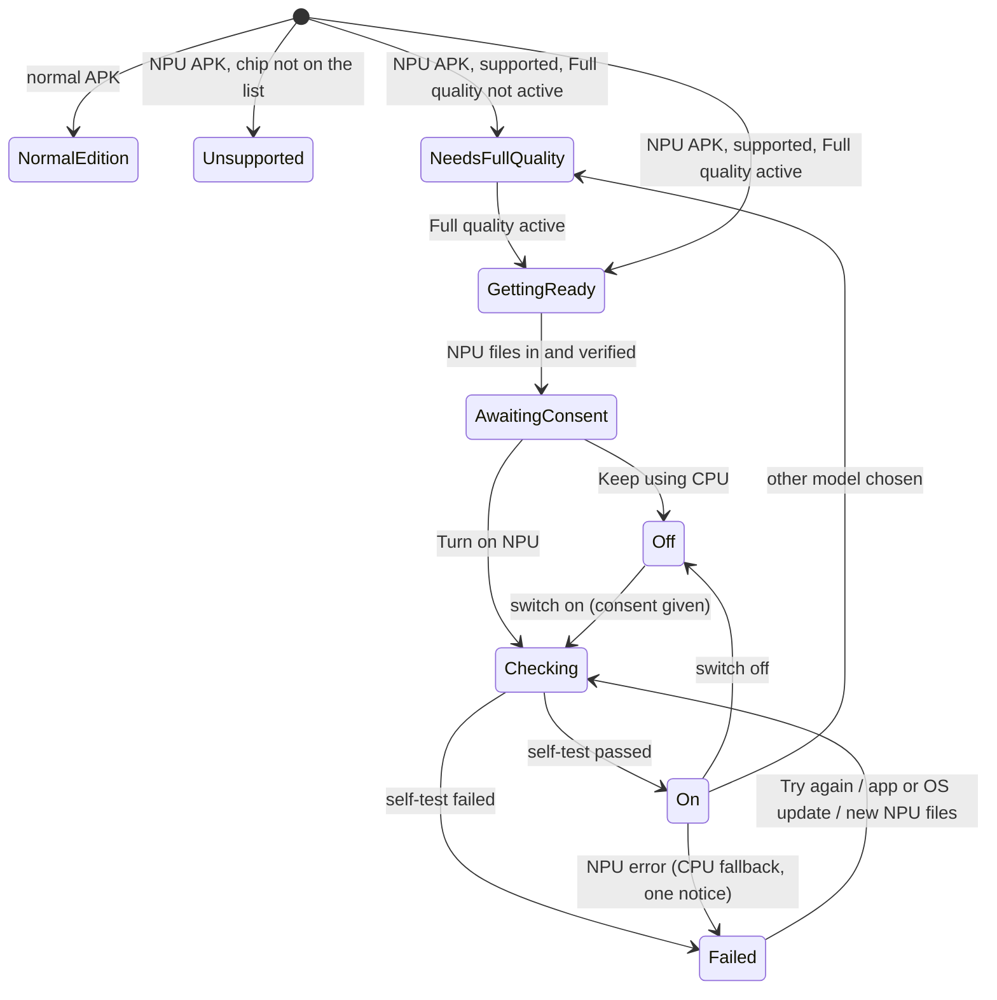

# 22 · NPU acceleration (Snapdragon Hexagon NPU)

Status: **blocked on licensing** (nothing of this is built or shipped in v0.x). Written 2026-10-25 by Opus from the user's
decision of 2026-10-25 ("a setting that is available, and on by default, only on supported Snapdragon chips; on other
phones shown disabled with a note"), the S26 Ultra NPU test (`research/2026-10-25-android-npu-test.md` §6) and the license
review (`research/2026-10-25-qnn-license-review.md`). It unblocks only when **all three** are true:

1. the user has answered the eligibility question of the license review §6.1a (where they live; Qualcomm's §10f);
2. Qualcomm has answered the review's §7 questions 1–4 in writing (which license applies, a free public app on GitHub,
   whether our compiled HTP context files are ours to ship, sublicenses after termination);
3. a lawyer has checked §7 questions 5–9 (export rules, the §9 indemnity, the GPL-3 "aggregate" reading of the separate
   process, the notice files, symbol stripping).

Until then the `npu-test` app stays local and unpublished, and nothing in this file goes into a release. The design
choices below already follow the review's recommendation, so nothing has to be redone if the answers are yes.

## 1. Goal

On phones whose Snapdragon NPU we have tested, make speech on the NPU instead of the CPU: on the S26 Ultra it was about
**1.8× faster than the same pipeline on the CPU** (bench RTF 0.383 vs 0.689; soak 0.45 vs sherpa's 0.58) and used about
**40 % less battery per audio minute than today's sherpa engine** (9.7 vs 15.9 mAh), with output the ear can't tell apart
(waveform SNR ≈ 33 dB vs the CPU, where Kokoro's own run-to-run difference is 22 dB; the user: both clips "sounded really
good"). The CPU engine stays the default engine of the app and the fallback for every NPU problem; the NPU is a plug-in
that can disappear (license withdrawn, driver broken, files deleted) without the user losing anything but speed.

## 2. User flow

There are **two builds** (license review §5.3, §6.1): the **normal edition** `lectrice-vX.apk` (no Qualcomm code; what
almost everyone installs) and the opt-in **NPU edition** `lectrice-npu-vX.apk` (same application id and signing key, so
installing one over the other is an in-place update that keeps books, places and settings). "Edition" below always means
which of the two APKs is installed.

**NPU edition, supported phone (the main path):**

1. The user installs the NPU edition (from GitHub Releases, where its release text warns about export rules) and goes
   through first run as usual (file 01). The Full quality card gets one extra line (§3.9).
2. When the Full quality model is installed and active, the NPU files (§3.6) download in the background on Wi-Fi. The
   app works on the CPU meanwhile. Settings shows the NPU row as "Getting ready".
3. When they're in, the **first-use screen** (§3.4) appears once, the next time the app is in front and not playing (or
   at once if the user opens the NPU row): "Use the phone's NPU?" with **Turn on NPU** (primary), **Keep using CPU** and
   **Read Qualcomm's license**.
4. **Turn on NPU** → the **self-test** runs (§3.3, about 20–40 s, "Checking that it sounds right…"). Passed → the app
   switches the engine to the NPU at the next sentence boundary (or at once if not playing). Failed → the row says why
   and the app stays on the CPU.
5. While charging, the phone compiles the longer-sentence files (§3.7) in the background; the row says "Preparing for
   long sentences" until done. Nothing changes for the user except fewer joins in long sentences afterwards.
6. If anything goes wrong later, the app goes back to the CPU by itself, says so **once** (snackbar, §3.5), and the row
   shows "Stopped working" with **Try again**.

**NPU edition, phone not supported:** the row is shown disabled with the note "Only on certain Snapdragon chips". Nothing
downloads, the first-use screen never appears.

**Normal edition:** the row is shown disabled with the note "Available in the NPU edition on certain Snapdragon chips".
On phones whose chip is on the allow-list (§3.1) the row also offers **About the NPU edition** (a short sheet with the
facts and a link to the releases page, §3.10). The row appears in the normal edition **only once an NPU edition has
actually been released** (build constant `NPU_EDITION_RELEASED`, false today); before that the normal edition shows
nothing about the NPU.



## 3. Rules & logic

### 3.1 What "supported" means (the support check)

Three gates, all needed, cheapest first. **Supported = gate 1 and gate 2 pass; usable = gate 3 passed too.**

| Gate | What | Where it runs | When |
|---|---|---|---|
| 1. **Allow-list** | `Build.SOC_MODEL` (API 31+; below API 31 → not supported) normalised (upper case, the part before the first `-`, so Samsung's "for Galaxy" bins like `SM8850-AC` match `SM8850`) is a key of the allow-list **and** the NPU edition contains that entry's HTP skel library | main process, no native code | every app start (it's a string compare) |
| 2. **Probe** | in the `:npu` process (§3.2): the QNN plugin registers, ORT reports exactly one QNN HTP device, the base context files of §3.6 load **with CPU fallback switched off** (`session.disable_cpu_ep_fallback = 1`), and the device's reported HTP arch (when ORT exposes it in the device metadata; UNVERIFIED) equals the allow-list's | `:npu` | before the first self-test, then as part of every engine load |
| 3. **Self-test** | §3.3 | `:npu` | before the NPU is used the first time, and again after any **revalidation trigger** (§3.3) |

**The allow-list** is a small JSON asset of the NPU edition (`assets/npu/allowlist.json`), one entry per chip we have
**tested on a real phone** (UNVERIFIED chips are never added on paper):

```json
{ "version": 1,
  "chips": [ { "socModel": "SM8850", "htpArch": 81, "qnnSocId": 88, "contextSet": "kokoro-v1.0.npu1.htp81", "testedOn": "Galaxy S26 Ultra (SM-S948B)" } ] }
```

- Why an allow-list and not only a runtime probe: context files are compiled per HTP generation (and SoC id), so we can
  only offer chips we have files for; a probe alone would also try chips that load but misbehave (the review of
  cedgeremek's work found per-generation numeric bugs, e.g. `Pow` on v75). The probe then catches what the list can't
  (a phone with the right chip but a broken vendor driver, a missing `libcdsprpc.so`).
- Adding a chip (e.g. SM8750 / v79, SM8650 / v75) = compile its context set on the laptop, run the phone checks of §9 on
  that phone, add the entry, ship a new NPU edition. Nothing else changes.
- Exynos, MediaTek, Tensor and older Snapdragon chips are never supported by this feature (no QNN HTP path or no tested
  files; `research/2026-10-25-android-npu-gpu.md` §3).

### 3.2 Where it runs: a separate `:npu` process (license review §4.4, design C)

**Hard rules** (they are what keeps the APK a GPL-3 "aggregate"; a build check enforces 1–3):

1. The NPU code is a separate Gradle module **`npu:service`** that depends on **nothing** of ours except the protocol
   module `npu:protocol` (AIDL + constants). It must not depend on `core:*`, `lectrice-ffi`, sherpa or pdfium.
2. It runs in its own process: `<service android:name=".NpuVocoderService" android:process=":npu" android:exported="false">`.
   `Application.onCreate` runs in every process, so `LectriceApp.onCreate` checks the process name first and, in `:npu`,
   **loads no native library of ours** (no `System.loadLibrary`, no JNA init) and builds no `AppContainer`.
3. The `:npu` process loads only: Microsoft's ONNX Runtime (MIT), Qualcomm's ORT QNN EP plugin (MIT), Qualcomm's QNN
   runtime libraries (proprietary), and our MIT/Apache Kotlin code. A test reads `/proc/<npu pid>/maps` on the test phone
   and fails if `libsherpa-onnx-c-api.so`, `liblectrice_ffi.so` or `libpdfium.so` is mapped.
4. **The interface is plain data**, versioned like a network protocol (`NPU_PROTOCOL_VERSION = 1`). Main → `:npu`:
   token ids (`int[]`), the style vector (`float[256]`), speed (`float`, always 1.0 today) and a request id. `:npu` →
   main: PCM (`float`, mono, 24 kHz) in a `SharedMemory` region (a 12.8 s clip is 1.2 MB, over Binder's 1 MB limit), its
   sample count, and timings (front / vocoder / iSTFT ms). No other types cross. Plus four control calls: `probe()`,
   `selfTest(cpuRtf)`, `compileBucket(frames)` and `setPowerMode(mode)`.
5. The text front end (text → token ids, which may call espeak-ng) and the voice table (`voices.bin` → style vector) stay
   in the **main** process (core C31); the neural model (front part on the CPU, vocoder on the NPU, iSTFT) runs in `:npu`.

What runs in `:npu` is the `npu-test` pipeline, cleaned up: `front.onnx` on ORT's CPU EP (tokens + style → durations,
decoder features, the harmonic source; Kokoro's random noise lives here), the window plan (`Windows.kt`: split at pauses
or word gaps when the sentence is longer than the largest bucket, 8-frame cross-fades), `vocoder-b{B}` on the HTP for each
window padded to the next bucket, and `istft.onnx` on the CPU. Each window output is checked (§3.5, the sanity guard).

Bonus of the process split: a native crash in the DSP driver kills `:npu`, not the app. The main process sees a
`DeadObjectException`, which is an NPU error like any other (§3.5).

### 3.3 The self-test (before enabling, and after changes)

Runs in `:npu` on built-in data only (never book text). Inputs come with the NPU files (`selftest/`, about 5 MB, made on
the laptop by the NPU tools): for **three invented sentences** (the voice-sample sentence of file 16, one about 6 s long
and one about 11 s long, so a single window, a medium bucket and the longest bucket/window path are all exercised):
token ids, style vector, the front's **expected durations**, a **stored front output** (so the vocoder input is fixed and
Kokoro's random noise doesn't matter) and the **reference audio** of the fp32 CPU vocoder for that stored input.

| # | Check | Pass when | Measured on the S26 (for the thresholds) |
|---|---|---|---|
| 1 | Front on the phone, same tokens + style | durations equal the stored ones exactly (the duration predictor has no noise) | — (deterministic; UNVERIFIED on the phone's ORT, allow ±1 frame per token if it isn't) |
| 2 | Vocoder on the NPU, stored front output | every sample finite; peak ≤ 1.0 after the usual clamp; no window all-silent where the reference isn't | all finite |
| 3 | Same, against the reference audio | waveform SNR **≥ 25 dB** for every sentence | 29.9–34.3 dB |
| 4 | Speed: end-to-end RTF of the three sentences (front + vocoder + iSTFT, after one warm-up) | **≤ 0.8 ×** the CPU engine's RTF on this phone | 0.383 vs 0.465–0.689 |
| 5 | Time budget | the whole test ≤ 90 s (else it counts as failed: something is very wrong) | ~25 s expected (4 s context load + 3 × 2 runs) |

- **CPU RTF for check 4:** the main process passes the CPU engine's sustained RTF from `speech_stats()` (core C17) or the
  thread self-benchmark's stored result (`research/2026-10-25-android-npu-gpu.md` §4.4). If neither exists, the main
  process first measures it with the CPU engine on the same three sentences (texts in the main process, CPU engine
  loaded, then unloaded) **before** `:npu` loads, so two engines never sit in memory at the same time.
- The self-test runs with the screen on and the app in front, or in a foreground service while the user waits on the
  row's "Checking…"; never silently in the background (it costs about a minute of full NPU + CPU use).
- **Result stored** in DataStore `npu.validation`: `{ passed, reason?, at, appVersionCode, buildFingerprint,
  contextSetId, qairtVersion, snrMinDb, npuRtf, cpuRtf }` (numbers only).
- **Revalidation triggers** (the stored result is ignored and the test runs again, without asking, the next time the NPU
  would be used; consent is not asked again unless the license file changed, §3.4): a new app version code (the QNN
  runtime may have changed), `Build.FINGERPRINT` changed (OS update: new DSP firmware or `libcdsprpc.so`), new or
  re-downloaded NPU files (`contextSetId` changed), or long-sentence files just compiled (§3.7: they get their own quick
  check of rows 2–3 on the 11 s sentence only).
- **Reasons** (for the row and the logs; registry-style names, Kotlin enum `NpuFailReason`): `NoDevice`, `LoadFailed`,
  `WrongOutput` (checks 1–3), `TooSlow` (4), `Timeout` (5), `Crashed` (the `:npu` process died during the test).

### 3.4 Consent: the first-use screen (license review §6.3)

- Shown **once** before the NPU is used the first time, in the NPU edition only. Copy as in §3.11 (the review's text,
  unchanged in meaning). Buttons: **Turn on NPU** (primary) · **Keep using CPU** · **Read Qualcomm's license** (opens the
  shipped `LICENSE.pdf` in the system PDF viewer through our `FileProvider`, or our in-app text view if no viewer is
  installed; the file itself is never changed).
- **Default on** (the user's decision) is honoured as: on supported phones the NPU is the pre-selected, primary choice,
  and it starts by itself right after the user agrees. It can't be on *without* the screen: the screen is how the user
  receives our sublicense terms (no reverse engineering, export laws).
- Stored: `npu.consent = { licenseSha256, at }` (the hash of the shipped `LICENSE.pdf`; nothing else). If a new app
  version ships a different `LICENSE.pdf`, the screen is shown again before the next NPU use; until then the CPU is used.
- **Keep using CPU** → switch off, `npu.userChoice = off`. The screen is not shown again; turning the switch on later shows
  it again only if consent was never given.
- The screen is also reachable from the row while consent is missing (tapping the switch opens it instead of toggling).

### 3.5 Fallback to the CPU (any NPU error)

**What counts as an NPU error:** the core error `SpeechAcceleratorFailed` (2004, new, core C33) raised by the NPU adapter
when `:npu` reports any failure, when the Binder call fails (`DeadObjectException`, `RemoteException`), when the service
can't bind within 5 s, when a window takes longer than its watchdog (**8 s** per window; `:npu` cancels the ORT run with
`RunOptions.setTerminate`), or when the sanity guard fails (non-finite samples, all-silent output for a non-silent token
span). `SpeechSynthesisFailed` (2003) keeps its meaning (this sentence can't be made, on any engine) and its file 12
handling.

**What happens** (in the Kotlin `EngineCoordinator`, file 10 §3.6, which owns the "which engine is loaded" decision):

1. The sentence that failed is **not** skipped: `stop_all_read_ahead()`, `reload_engine(cpu fp32)`, then the same
   `speak_sentence` again. The listener hears a short "Preparing audio…" (about 1–2 s on the S26), never a gap of text.
2. `npu.validation.passed = false`, `reason` set, so the NPU isn't tried again by itself (see "retry" below).
3. **One-time notice:** a snackbar on whatever screen is showing (or, if the app is in the background, nothing now and
   the snackbar at the next app open), copy §3.11: "The NPU stopped working, so Lectrice switched to the CPU." with
   **Details** (→ Settings, NPU row). Shown at most **once per failure state**: not again until the NPU has worked again
   and failed again. The media notification never mentions it.
4. A running export continues on the CPU at its current part (§3.8); queued ones run on the CPU.

**Retry:** never automatic in the same app version + OS build, except one quiet retry for a **process death of `:npu`
while not in the self-test** (Android may kill a background process under memory pressure): rebind once; a second death
within 10 minutes → fallback as above. The NPU is tried again: on **Try again** in Settings (runs the self-test), and on
any revalidation trigger of §3.3.

**Crash guard** (file 12 §3.5 style): the `:npu` process dying doesn't kill the app, so no crash loop is possible in the
main process. If `:npu` dies twice in a row **during engine load or the self-test**, the reason is `Crashed` and the
switch shows "Stopped working".

### 3.6 Which models, and the NPU files

- **Full quality (fp32) only.** The NPU files are made from the official fp32 `model.onnx` (the vocoder buckets and the
  front part are cut out of it), so the NPU's sound is Full quality's sound at fp16. They need the Full quality bundle
  installed **and active** (they share its `voices.bin`, `tokens.txt`, lexicons and `espeak-ng-data`, which the main
  process uses for C31). With "Small" or the official int8 model active, the row says "Works with the Full quality voice
  model" and offers **Use Full quality** (= the T2 "Use this", file 11). Rationale: on the HTP every model runs at fp16
  anyway, so an NPU set made from "Small" would sound and run like this one; one set per chip is enough.
- **NPU files** = a separate download of the NPU edition, from our own model release (Apache-2.0 Kokoro derivatives; the
  HTP context files' status is Qualcomm question 3 of the review: if they count as "the Software", they can't be
  downloaded separately and must instead be compiled on the phone, §3.7, from the plain ONNX vocoder; the manifest
  supports both). Pinned in the app like model bundles (file 01 §3.4: manifest with URL, size, SHA-256 per file, resume,
  verify, `installed.json` last):

| File | Size (measured 2026-10-25) | Note |
|---|---|---|
| `front.onnx` | 247 MB | CPU part. fp16-stored weights would halve it (UNVERIFIED on the phone's ORT; spike N4) |
| `istft.onnx` | 7 KB | |
| `ctx/vocoder-b{64,96,128,192,224,288,320}.ctx.onnx` | 501 MB (48–108 MB each) | HTP v81 contexts, QAIRT 2.50.40, fp16 |
| `src/vocoder-dyn.onnx` | 79 MB | the masked fp32 vocoder; source for phone-side compiles (§3.7) and for recompiling after a driver change |
| `selftest/` | ~5 MB | §3.3 |
| **Download total** | **≈ 830 MB** | Wi-Fi only by default (§5); shown before it starts |

- **Where:** `filesDir/models/<fp32 bundleId>/npu/<contextSetId>/` (e.g. `…/npu/kokoro-v1.0.npu1.htp81/`). Not
  `cacheDir`: the files are a big download or minutes of compiling and battery to remake, and Android may empty
  `cacheDir` at any time (file 20 §3.1), which would silently turn the NPU into "Getting ready" again. They are counted
  under the Full quality model on the Storage screen ("Full quality · 370 MB + NPU files 1.25 GB") and deleted with it.
- **Deleting only the NPU files:** NPU page / row → "Remove NPU files" (switch goes off, CPU, frees the space). Download
  again with the switch.
- **Size is the weak point** (≈ 1.25 GB with the long buckets of §3.7, vs 370 MB for the model). Spike N4 (§8) must bring
  it down before release; targets: fp16-stored `front.onnx` (−124 MB), and **one context file with shared weights for
  all buckets** (QNN HTP weight sharing via ORT's `ep.share_ep_contexts`, UNVERIFIED for this plugin version), which
  would turn ~10 × 40 MB of repeated weights into one copy. Budget for release: **≤ 500 MB** on the phone.

### 3.7 Longer windows: compiled on the phone

- The base set's largest bucket is 320 frames (4 s); longer sentences are split into windows, and the test showed the
  joins change the sound measurably (spectral SNR 13–24 dB in long sentences). Buckets 384–1024 couldn't be compiled on
  the laptop (RAM). The phone has the RAM.
- **Long set:** buckets **512 and 1024** (6.4 s, 12.8 s). Every test sentence fitted in one 1024 window. Estimated sizes
  (linear from the measured ones, UNVERIFIED): ~150 MB and ~270 MB. Compile time on the phone: unknown (the test app's
  `npu_compile` mode wasn't run; laptop: 318 s for B320); budget **≤ 10 min per bucket**.
- **When:** a WorkManager job `NpuCompileWorker`, constraints **charging + battery not low + storage not low**, foreground
  (`dataSync`/`specialUse` type per file 17, notification "Preparing the NPU for long sentences"), one bucket at a time,
  smallest first. It runs in `:npu` (`compileBucket(frames)`: ORT session from `src/vocoder-dyn.onnx` with the frame
  dimension fixed by a free-dimension override, `ep.context_enable = 1`, `ep.context_file_path` = the target). Writes
  to `…/compiled/vocoder-b{B}.ctx.onnx.part`, renamed when the session loads back from it. Cancelled (and retried later)
  when unplugged, at thermal SEVERE, or when the user starts listening (the NPU is shared).
- The NPU works **before** the long set exists (with 4 s windows); when a long bucket is ready, it gets the short check
  of §3.3 and is then used for windows that fit it. Failure of a long bucket (compile error, check failed) → it's left
  out (logged), the base set keeps working; not an NPU error.
- If the context files were not allowed to be downloaded (§3.6), the same worker compiles the base set first (then the
  NPU is "Getting ready" until B64–B320 exist; this one doesn't wait for charging, but asks first: "Preparing the NPU
  takes about N min and uses battery. Plug in to do it now, or it starts the next time the phone charges.").

### 3.8 Engine ids, cache and exports (NPU and CPU clips never mix)

- **Engine id = model id + accelerator tag** (core C34): `"<modelId>"` on the CPU, `"<modelId>+<tag>"` on an
  accelerator. NPU example: `kokoro-v1.0+npu1-htp81-b320` = NPU file set version 1, HTP v81, largest bucket 320. When the
  long set arrives the tag becomes `…-b1024` (the windowing, and so the sound of long sentences, changes).
- **Audio cache:** keyed by the full engine id (as today, C11), so a CPU clip is never played while on the NPU and the
  other way round; switching re-makes the read-ahead window (10 listening-minutes) and the other engine's clips age out
  of the 1-hour window. Voice samples are per full engine id too (`samples/<engineId>/…`).
- **Exports are tied to the model id, not the full id** (C34 changes C12's rule): an export started on the NPU may
  continue on the CPU after a fallback, and the other way round, **at part boundaries only** (a part is always made by
  one engine). The same-target rule and the export file name use the model id, so an NPU/CPU switch never creates a
  second export of the same book. The record stores which full engine id made each part (`parts[i].engineId`, logs
  only). Reason this is allowed while the cache rule is strict: inside a part the sound must be seamless; between ~10-min
  parts the NPU/CPU difference (33 dB) is inaudible, and losing hours of finished parts would be much worse.
- **Which engine exports use:** the loaded one (the NPU when it's on), so exports get the battery saving. The export
  page shows no NPU choice (it's not a quality choice); its time estimate uses the loaded engine's RTF (C17).

### 3.9 Heat, battery, power modes

- The NPU doesn't change the read-ahead governor (file 08 §3.3): the S26 reached thermal SEVERE on the NPU too, so SEVERE
  still means Reduced and CRITICAL still means Off + exports paused. **Heat never moves work from the NPU to the CPU**
  (the CPU makes more heat per audio minute).
- **QNN power mode** (`setPowerMode`, ORT QNN `htp_performance_mode`; per-run switching UNVERIFIED, else per session at
  load): defaults until spike N5 measures them — first sentence after Play or a jump: `burst`; read-ahead and exports:
  `sustained_high_performance`; thermal SEVERE or battery saver: `balanced`; ≤ 15 % battery and not charging:
  `power_saver`. The `EngineCoordinator` sets it from the governor's inputs; logged on change.
- **Battery saver:** the NPU **stays on** (it is the cheaper engine); only the power mode and the governor's read-ahead
  rules change.
- **First run note (NPU edition, supported phone):** the Full quality card (S2, file 01 §3.8) adds "On this phone it can
  use the NPU: faster, less battery. That needs another 830 MB, downloaded later on Wi-Fi."

### 3.10 The two editions in the UI

| | Normal edition | NPU edition |
|---|---|---|
| NPU row | disabled; "Available in the NPU edition on certain Snapdragon chips"; only after an NPU edition was released | the states of §4 |
| "About the NPU edition" | sheet, only on allow-listed chips: what it does, that it contains Qualcomm's closed libraries, that installing it over this app keeps everything, **Open the releases page** (browser; no network call by the app) | — |
| About → "Qualcomm AI Runtime" | — | its own entry (not in the open-source list), copy §3.11, with **View Qualcomm license** / **View Qualcomm notices** (the unchanged `LICENSE.pdf` and `NOTICE.txt` from the AAR) |
| Open-source licenses | as today | + ONNX Runtime (MIT, Microsoft) and the ORT QNN EP (MIT, Qualcomm + Microsoft) |
| Version line (file 18) | "Version 0.x.y · core 0.x.y" (as today) | "Version 0.x.y NPU edition · core 0.x.y" |
| Updates | GitHub Releases | the same release has both APKs; installing the normal APK over the NPU one removes the Qualcomm code and keeps all data |

The "About the NPU edition" sheet doesn't say "faster on your phone" for non-tested phones (the button only exists on
allow-listed chips), and it never names Qualcomm logos (review §3b): plain words "Snapdragon NPU".

### 3.11 Copy (new, Opus; the consent text from the license review §6.3)

| Where | Text |
|---|---|
| Row title | "Use the NPU" |
| Row, on | "Faster speech, less battery" |
| Row, getting ready (download) | "Getting ready · 312 of 830 MB" · waiting: "Waits for Wi-Fi · 830 MB" |
| Row, checking | "Checking that it sounds right…" |
| Row, on + compiling | "On · preparing for long sentences while charging" |
| Row, off (consent given) | "Off · Lectrice uses the CPU" |
| Row, failed | "Stopped working, so Lectrice uses the CPU" + text button "Try again" |
| Row, not Full quality | "Works with the Full quality voice model" + text button "Use Full quality" |
| Row / note, NPU edition, unsupported | "Only on certain Snapdragon chips" (+ on the NPU page: "This phone's chip isn't one of them.") |
| Row / note, normal edition | "Available in the NPU edition on certain Snapdragon chips" |
| Fail reasons (NPU page) | NoDevice "The phone didn't offer its NPU." · LoadFailed "The NPU files didn't load." · WrongOutput "The NPU's speech didn't match the CPU's." · TooSlow "The NPU wasn't faster than the CPU on this phone." · Timeout "The check took too long." · Crashed "The NPU part of Lectrice stopped unexpectedly." · runtime error "It stopped working while making speech." |
| Snackbar | "The NPU stopped working, so Lectrice switched to the CPU." · action "Details" |
| First-use title | "Use the phone's NPU?" |
| First-use body | "Lectrice can make speech on your phone's Snapdragon NPU. It's usually faster and uses less battery. It uses Qualcomm's closed-source libraries, which are included in this edition under Qualcomm's license." / "By turning it on you agree not to reverse engineer, decompile or disassemble those libraries, and to follow U.S. export and sanctions laws. They're provided as is, without warranty." / "Everything still runs on your phone. Nothing is sent anywhere. You can switch back to the CPU at any time in Settings." |
| First-use buttons | "Turn on NPU" · "Keep using CPU" · "Read Qualcomm's license" |
| Compile ask (only if contexts can't be downloaded) | "Preparing the NPU takes about {n} min and uses battery. Plug in to do it now, or it starts the next time the phone charges." · "OK" |
| About entry | "Qualcomm AI Runtime" / "This edition of Lectrice includes Qualcomm® AI Runtime (QNN) libraries, © Qualcomm Technologies, Inc. They are proprietary software provided under the Qualcomm AI Stack License, not under Lectrice's MIT / Apache-2.0 license or the GPL-3.0. They run only in Lectrice's separate NPU process." / "View Qualcomm license" · "View Qualcomm notices" / "Qualcomm, Snapdragon and Hexagon are trademarks of Qualcomm Incorporated. Lectrice is not affiliated with or endorsed by Qualcomm." |
| "About the NPU edition" sheet | "The NPU edition" / "A separate download of Lectrice that can make speech on the NPU of certain Snapdragon phones, including this one: usually faster and lighter on the battery." / "It contains Qualcomm's closed-source libraries under Qualcomm's license. Everything else is the same open-source app." / "Install it over this app to keep your books, places and settings. Installing this edition again switches back." / "Open the releases page" · "Close" |

## 4. States

| State | Edition | Row (switch) | Extra |
|---|---|---|---|
| Hidden | normal, no NPU edition released yet | not shown | — |
| NormalEdition | normal | disabled, off; note | "About the NPU edition" on allow-listed chips |
| Unsupported | NPU | disabled, off; "Only on certain Snapdragon chips" | — |
| NeedsFullQuality | NPU | disabled; "Works with the Full quality voice model" | "Use Full quality" |
| GettingReady (waiting Wi-Fi / downloading / verifying) | NPU | switch on but disabled-looking (progress subtitle) | progress; "Pause" / "Download now on mobile data" on the NPU page |
| AwaitingConsent | NPU | off | the first-use screen (once) |
| Checking | NPU | on, spinner | ~30 s |
| On | NPU | on | "Preparing for long sentences" while compiling |
| Off | NPU | off | "Remove NPU files" |
| Failed | NPU | off; reason | "Try again"; the one-time snackbar |
| Download failed / checksum | NPU | off; S3c-style error text | "Try again" |

## 5. Edge cases

- **OS update changes the HTP driver / DSP firmware:** `Build.FINGERPRINT` changed → self-test again before the next
  NPU use (CPU meanwhile, no notice unless it fails). If contexts no longer load (`LoadFailed`), the worker recompiles the
  base set from `src/vocoder-dyn.onnx` while charging and then runs the test; still failing → Failed.
- **App update with a new QNN runtime (QAIRT) version:** contexts are tied to the QAIRT version they were compiled with;
  the app's manifest names the `contextSetId` it needs, so a new version means new NPU files (download, or recompile) and
  then the self-test. Old files are deleted after the new ones pass.
- **Model switch** (Full quality → Small): NeedsFullQuality; `reload_engine(small)`; the NPU files stay (switching back
  doesn't download again).
- **Full quality deleted:** not possible while it's in use (file 11); deleting it later deletes its NPU files too.
- **Low storage:** the download checks space first (file 01 §3.4 rule: size × 1.1 + 200 MB); short → the row says
  "Needs about 830 MB free" and offers **Free up space** (Storage screen). The compile worker needs `storage not low`
  and 1.1 × the bucket's estimated size; an out-of-space write → that bucket is skipped until next time (`StorageFull`
  logged, not shown).
- **Metered network:** the NPU files never download on mobile data unless the user taps "Download now on mobile data"
  on the NPU page (the user is on a metered network themselves).
- **Another app is using the NPU** (camera, an AI assistant): runs get slower (RTF in `speech_stats`) or fail; a failure
  is an NPU error (fallback). Slowness alone never falls back; the slow-phone tip of file 12 covers it as on the CPU.
- **Export running when the NPU fails or is toggled:** the running part is redone on the new engine (exports continue by
  model id, §3.8). Never two engines in memory: the CPU engine is loaded only after `:npu` has released its sessions.
- **Memory:** `:npu` holds `front.onnx` + all contexts (the test's VmHWM was 1.73 GB with **both** the NPU and a CPU
  vocoder loaded; NPU only: UNVERIFIED, spike N3). The main process unloads its CPU engine while the NPU is active.
  `onTrimMemory` ≥ BACKGROUND while not playing → unbind `:npu` (file 08 rule 4 applies to it).
- **Idle:** no playback and no job for 5 min → unbind `:npu` too (Android then kills it); the next play rebinds (context
  load ~4 s: the first sentence shows "Preparing audio…" a bit longer than on the CPU).
- **The user installs the normal APK over the NPU one:** the NPU files stay in `filesDir` (unused; the Storage screen
  shows them with "Remove NPU files") so going back doesn't download again. Settings shows NormalEdition.
- **Qualcomm ends the license** (review §5): we delete the NPU APKs from every release and ship a normal update; the app
  never phones home, so nothing changes on phones until the user installs the normal APK.
- **Process death of the main process while `:npu` compiles:** the worker owns the job; WorkManager restarts it.

## 6. Where it lives (decision: a new `SpeechEngine` adapter, not a vocoder split of the core's port)

**Decision.** The NPU is **one more adapter behind the core's existing `SpeechEngine` port** (text + voice + speed → PCM),
assembled by the ffi like the sherpa adapter. Inside that adapter the work is split at the **token boundary**: text →
token ids in the main process, tokens → PCM in `:npu`. The core's port is not split into "front" and "vocoder".

**Why not a vocoder-only split in the core:** it would put Kokoro concepts (tokens, style vectors, frames, vocoder) into
the domain, which the architecture forbids ("nothing outside the adapter mentions Kokoro"); the CPU adapter can't use it
anyway (sherpa doesn't hand out its intermediate results); and the license review needs the cut at the token boundary,
between processes, not inside one engine. The fallback is an engine reload in the shell either way, so a finer split
buys nothing.

| Piece | Repo / module | Notes |
|---|---|---|
| Kokoro token front end (text → token ids, sherpa-identical) | main repo, `lectrice-infra/src/speech/kokoro_frontend/` (C31) | OS-agnostic, testable on the laptop against sherpa; reusable by a LiteRT GPU adapter |
| `KokoroTokenEngine` (a `SpeechEngine`: front end + voice table + an `AcousticBackend` + engine id) and the `AcousticBackend` trait (infra-level, Kokoro-specific) | main repo, `lectrice-infra/src/speech/kokoro_token/` (C32) | knows nothing of Android, QNN or processes |
| `SpeechAcceleratorFailed` 2004 | main repo, `lectrice-domain/src/error.rs` (C33) | |
| Engine id = model id + accelerator tag; exports by model id | main repo, domain + app (C34) | |
| `NpuBackend` (implements `AcousticBackend` by calling the Kotlin foreign trait `NpuVocoderClient`) and `EngineConfig::KokoroNpu` | `lectrice-android/rust/lectrice-ffi` | the only Rust that knows the NPU exists |
| `NpuVocoderClient` (Binder client, SharedMemory, timeouts, rebind) | `lectrice-android`, module `core:npu-client` (main process) | depends on `npu:protocol` |
| `INpuVocoder.aidl`, `NPU_PROTOCOL_VERSION`, request/response constants | module `npu:protocol` | no dependencies |
| `NpuVocoderService` (`:npu`): ORT + QNN plugin, front/vocoder/iSTFT sessions, `Windows`, self-test, compile, power mode | module `npu:service` (only in the `npu` product flavor) | depends on `npu:protocol` and the ORT/QNN AARs only |
| `NpuController` (support check, states of §4, validation, consent, fallback decisions) | `core:playback` next to `EngineCoordinator` | Kotlin; reads `Build`, DataStore, the allow-list |
| NPU files download | `ModelInstaller` (file 01), a second manifest | |
| `NpuCompileWorker` | `core:data` (worker), runs the compile through the client | |
| UI rows, NPU page, first-use screen, About entry, edition sheet | `feature:settings` | design: `docs/2026-10-25-android-npu-toggle-brief.md` (user picks) |
| Build | product flavors `standard` (default) and `npu` (`-Plectrice.npu=true` → adds `npu:service`, the QNN AARs, `<uses-native-library libcdsprpc.so required=false>`, `useLegacyPackaging`, `ADSP_LIBRARY_PATH` set in `:npu` before the first session); `LICENSE.pdf`/`NOTICE.txt` copied from the AAR into assets at build time, never into git | same `applicationId`, same signing key |

## 7. Data and persistence

- DataStore: `npu.userChoice` (on|off|unset), `npu.consent { licenseSha256, at }`, `npu.validation` (§3.3),
  `npu.failNoticeShown` (bool, reset when the NPU works again), `npu.powerMode` (last set, for logs).
- Files: `filesDir/models/<fp32 bundleId>/npu/<contextSetId>/` with `installed.json`, `front.onnx`, `istft.onnx`, `ctx/`,
  `compiled/`, `src/`, `selftest/`.
- Core: export records gain `parts[i].engineId` (C34); cache folders use the full engine id (`audio/<docId>/c<v>/<engineId>/…`,
  with `+` in the folder name, allowed on Android, Linux and Windows).
- Logs (README §4.6): ids, states, reasons, timings, RTF, SNR numbers, power mode, sizes. Never token ids of book text,
  never audio, never the sentence.

## 8. Decisions and open questions

| Decision | By | When |
|---|---|---|
| A setting available and on by default only on supported Snapdragon chips; disabled with a note elsewhere | user | 2026-10-25 |
| No QNN in v0.x; only as an opt-in **NPU edition APK**, never as a download pack; NPU in its own `:npu` process; CPU default + fallback; notices + first-use screen | license review, adopted by the coordinator | 2026-10-25 |
| "On by default" = pre-selected and started right after the first-use screen (consent can't be skipped) | Opus | 2026-10-25 |
| Normal edition shows the row disabled with "Available in the NPU edition…" (only once an NPU edition exists), plus an info sheet on allow-listed chips | Opus | 2026-10-25 |
| Support = tested allow-list + probe + self-test | Opus | 2026-10-25 |
| A new `SpeechEngine` adapter split at the token boundary, not a vocoder split of the port | Opus | 2026-10-25 |
| Full quality only; NPU files in `filesDir` under the model | Opus | 2026-10-25 |
| Engine id = model + accelerator tag; cache by full id, exports by model id (part boundaries) | Opus | 2026-10-25 |
| Heat never moves work to the CPU; battery saver keeps the NPU | Opus | 2026-10-25 |
| Settings UI: options in the brief | **user picks** | open |

**Open (blocking):** the three licensing gates in the status line.

**Open (spike N, after licensing, on the S26 Ultra; nothing here needs the user):**

| # | Question |
|---|---|
| N1 | Does the C31 front end match sherpa's tokens on the invented corpus and on the local book word lists (skipped/changed words ≤ 0.1 %, the S6 method)? Can it reach espeak-ng inside sherpa's Android `.so`, or does it need its own `libespeak-ng.so`? |
| N2 | The `:npu` service end to end: Binder + SharedMemory overhead per sentence (target < 5 ms), first sound after bind (target ≤ 1.5 s warm, ≤ 5 s cold incl. context load). |
| N3 | Memory of `:npu` alone, and of the main process with the CPU engine unloaded. |
| N4 | Size: fp16-stored `front.onnx`; one weight-shared context for all buckets; the ≤ 500 MB budget. |
| N5 | Power modes: RTF, mAh per audio minute and heat for `burst` / `sustained_high_performance` / `balanced` / `power_saver`, cool start, 10-min soaks (the test only ran `burst`). |
| N6 | Phone-side compile of B512 / B1024 (`npu_compile`): time, peak memory, file size; the self-test on long sentences with them. |
| N7 | Does `htp_performance_mode` switch per run, or only per session? Does ORT expose the HTP arch in the device metadata (probe gate)? |

## 9. Done when

- [ ] Licensing gates 1–3 are closed with a "yes", recorded in `CLAUDE.md`.
- [ ] The normal edition builds with no Qualcomm or ORT file in the APK (`unzip -l` check in CI) and shows the
      NormalEdition row only when `NPU_EDITION_RELEASED` is true.
- [ ] In the NPU edition on the S26 Ultra: consent screen → self-test passes → playback on the NPU; logs show the
      `+npu1-htp81` engine id on every clip hit; sustained RTF ≤ 0.55 and mAh per audio minute ≤ 11 in a 10-min
      unplugged soak.
- [ ] On an unsupported phone (S10+) the row is disabled with the note; `:npu` never starts (no process in `ps`).
- [ ] Killing `:npu` (`adb shell kill`) while playing → one rebind; twice in 10 min → CPU, the snackbar once, playback
      continues at the same sentence with no skipped sentence.
- [ ] A faked wrong output (debug flag: add noise in `:npu`) fails the self-test with `WrongOutput`; the app stays on
      the CPU.
- [ ] Toggling NPU on/off during an export keeps every finished part; the final M4B plays through and its file name is
      the same as a CPU-only export's.
- [ ] `/proc/<npu pid>/maps` contains no `libsherpa-onnx-c-api.so`, `liblectrice_ffi.so`, `libpdfium.so` (test on the phone).
- [ ] A changed `Build.FINGERPRINT` (debug override) reruns the self-test before the next NPU use.
- [ ] About shows the "Qualcomm AI Runtime" entry and opens the unchanged `LICENSE.pdf` (SHA-256 equal to the AAR's).
- [ ] Storage shows the NPU files under Full quality; "Remove NPU files" frees them and switches to the CPU.

## 10. Design screens

None in the approved mockup. **New, needs the user's pick:** `docs/2026-10-25-android-npu-toggle-brief.md` (three
options for where the row lives and how the states look; Fable draws them in a new "NPU" section of
`design/2026-10-23-android-quiet-v2.html`, screenshots `design/screens/android-npu-*.png`). Covers: the row in every
state of §4, the NPU page (option B), the first-use screen, the fallback snackbar, the About entry and the "About the NPU
edition" sheet.
