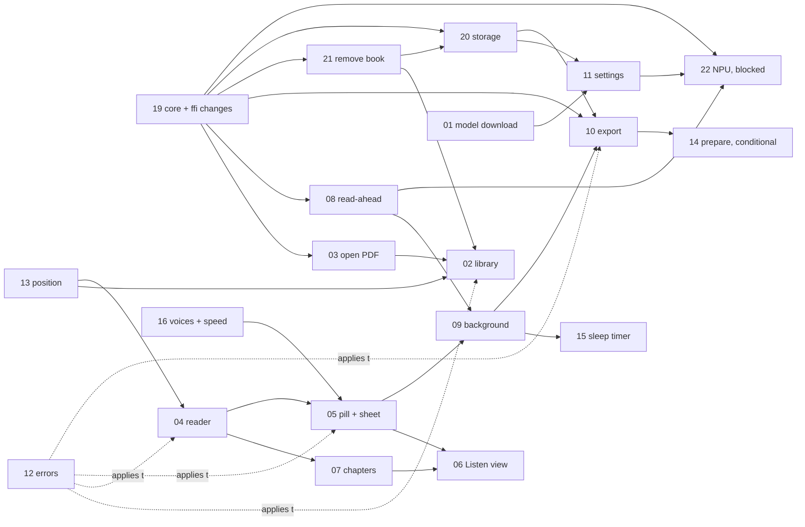

# Lectrice for Android: feature logic spec (index)

Status: **written 2026-10-23 by Opus, for the user's review; updated 2026-10-24 with the user's decisions of that day; 2026-10-25: file 22 (NPU, blocked on licensing) added**
(remove from library, core `v0.2.0`, the read-ahead stop rule, the voice sample, export space checks and partial export,
storage visible in Android's Settings). Nothing here is built yet.
This folder is the exact behaviour of every feature of the Android app. A build agent gets **one feature file plus this
README** and must be able to build that feature from them alone.

Sources, newest first (when two disagree, the newer one wins and the conflict is listed in "Changes vs spec" below):

1. The user's decisions of 2026-10-24 ("Remove from library" in v1; every core change in `v0.2.0`; a concrete read-ahead
   stop rule; one fixed voice-sample sentence; predict export size and offer a partial export; pause and keep parts when
   space runs out; cache and exports visible in Android's Settings) and of 2026-10-23 (export M4B only, Listen view over
   the lock screen as an off-by-default setting, chapters access "do the best practice", Quiet v2 approved). Recorded in
   `CLAUDE.md`.
2. The approved design: `design/2026-10-23-android-quiet-v2.html` and its brief `docs/2026-10-23-android-quiet-v2-brief.md`
   ("the v2 brief"), on top of `docs/2026-10-23-android-design-brief.md` ("the first brief"; its tokens, type, components
   and copy still apply).
3. `docs/2026-10-23-android-spec.md` ("the spec": FFI API, threads, Media3, storage, licenses).
4. The core as it is on branch `feature/core-v1.1` (`backend/crates/`, `docs/progress/core-v1.1.md`, `CHANGELOG.md`) and the
   shared contract `docs/2026-10-21-design-spec.md` ("the web spec").
5. `docs/2026-10-23-android-m1-spike-plan.md` ("the spike plan"), `research/2026-10-23-android-options.md` §4.1
   (Telegram's principles), `rules/` (universal parts only).

**Public repo rule:** every example in these files is invented (the mockup's "The Long Book" etc.). Nothing comes from the
user's books.

---

## 1. Features

Status: **decided** = fully specified, nothing waits on anyone · **open** = a question for the user is listed in its §8 ·
**spike** = some numbers or a part depend on the M1 spike results · **conditional** = built only if the spike says so.

| # | File | One line | Status | Needs first |
|---|---|---|---|---|
| 01 | [01-first-run-and-model-download.md](01-first-run-and-model-download.md) | Welcome, pick fp32 or int8, resumable checked download or import from a file, "Not now, just read" | spike (the speed notes on the cards) | 11 (model page), 17 |
| 02 | [02-library.md](02-library.md) | Continue card, Recent list with cover tiles, round "Open PDF" button, banners, long-press book sheet | decided | 03, 13, 21 |
| 03 | [03-open-and-process-pdf.md](03-open-and-process-pdf.md) | System picker / "Open with", copy, clean once (by SHA-256), errors, already-in-library | spike (page progress for long imports) | core import |
| 04 | [04-reader.md](04-reader.md) | Large text, page chips, highlight, tap a sentence to jump, follow-scroll, "Back to current" | decided | 13 |
| 05 | [05-player-pill-and-sheet.md](05-player-pill-and-sheet.md) | The pill (expanded/collapsed), its gestures, the speed scrubber, the player sheet | decided | 04, 16, 15 |
| 06 | [06-listen-view.md](06-listen-view.md) | The big-text "stage" opened from the pill, eyes-free gestures, over the lock screen (setting) | decided | 05, 07 |
| 07 | [07-chapters.md](07-chapters.md) | Current chapter label, the full-height searchable outline, section jumps, how you reach it | decided | 04 |
| 08 | [08-read-ahead-and-cache.md](08-read-ahead-and-cache.md) | 10 listening-minutes ahead, ~1 hour kept per book, 1 GB cap in `cacheDir`; the read-ahead governor (Full / Reduced / Off: pause, sleep timer, battery, heat) | decided | core C13, C14, C15, C29 |
| 09 | [09-background-playback-and-lock-screen.md](09-background-playback-and-lock-screen.md) | Media3 service, sentence playlist, lock screen / notification / Bluetooth, sentence as the title | decided | 05, 08 |
| 10 | [10-export.md](10-export.md) | Whole-book M4B with chapters: voice, model, baked-in speed, read code; space check before start, partial export, pause-and-keep-parts when space runs out; resumable parts; save (move)/share | decided | core C10–C12, C18, C19, C24, C30 |
| 11 | [11-settings.md](11-settings.md) | Settings screen, voice model page (switch/delete), the Storage row | decided | 01, 08, 20 |
| 12 | [12-errors-states-and-slow-phones.md](12-errors-states-and-slow-phones.md) | Every error and empty/loading/offline state, the slow-phone tip, low memory, process death | spike (the slow-phone bands) | all |
| 13 | [13-reading-position-and-progress.md](13-reading-position-and-progress.md) | Saving the place, percent read, time left, "Continue", finished books, re-cleaned books | decided | core |
| 14 | [14-prepare-mode.md](14-prepare-mode.md) | Make a chapter or the book ahead while charging | **conditional** (only if the spike is amber/red) | 08, 10 |
| 15 | [15-sleep-timer.md](15-sleep-timer.md) | Off / 15 / 30 / 45 min / 1 h / End of chapter | decided | 05, 07 |
| 16 | [16-voices-and-speed.md](16-voices-and-speed.md) | Voice list with samples (one fixed sentence, made on demand, cached), per-book voice and speed, defaults | decided | core C16 |
| 17 | [17-permissions-and-system-integration.md](17-permissions-and-system-integration.md) | Notifications, foreground services, battery page, show-when-locked, intents, `manageSpaceActivity`, backup rules | decided | — |
| 18 | [18-about-licenses-and-updates.md](18-about-licenses-and-updates.md) | Version line, licenses screen, source link, updates via GitHub Releases, data kept across updates | spike (GPL or not depends on sherpa 2.0) | — |
| 19 | [19-core-and-ffi-changes.md](19-core-and-ffi-changes.md) | Every new core (main repo) and `lectrice-ffi` change these features need (C10–C30), incl. **baked-in speed (time-stretch)**; all ship in core **`v0.2.0`** | decided | — |
| 20 | [20-storage.md](20-storage.md) | Where every file lives, what Android's Settings → Apps → Lectrice → Storage shows ("Cache", "Clear storage" → our screen), the Storage screen | decided (3 UNVERIFIED device checks) | core C15, C19, C28, C29 |
| 21 | [21-remove-from-library.md](21-remove-from-library.md) | "Remove from library": book sheet, confirm, 8 s undo, what's deleted (exports kept by default), playing/exporting books | decided | core C28 |
| 22 | [22-npu-acceleration.md](22-npu-acceleration.md) | "Use the NPU" on tested Snapdragon chips: opt-in **NPU edition** APK, `:npu` process, allow-list + probe + self-test, first-use screen, CPU fallback with one notice, NPU files, engine ids | **blocked on licensing** (user eligibility, Qualcomm's written answers, a lawyer; license review §6–§7); Settings UI: user picks from the brief | core C31–C34, 01, 08, 10, 11 |

### Dependencies (what must exist before what)

## 2. Suggested build order (milestones)

The milestones are the spec's (§16), filled with the features.

| Milestone | Features | Done when |
|---|---|---|
| **M0** core C1–C9 (spec, on `feature/core-v1.1`; **not tagged**: `v0.2.0` is tagged at the end of M1.5) | — | spec §16 |
| **M1** go/no-go spike | — | the spike report is read and the user decided GO / Prepare-first |
| **M1.5** the rest of core **`v0.2.0`** (file 19: C11, C13–C17, C22, C25–C29 first; C10, C12, C18, C19, C23, C24, C30 for export) | 19 | main-repo tests green, **tag `v0.2.0`**, Android pin set to it |
| **M2** design system, library (incl. remove), open PDF, reader, chapters, position, settings shell, fake playback | 02, 03, 04, 07, 13, 21, 11 (theme, text size), 12 (their states) | the M2 line of spec §16 |
| **M3** real playback | 05, 06, 08, 09, 15, 16, 17 (notifications, media), 12 (slow phone) | a whole chapter with the screen off, earbuds work, Listen view works over the lock screen when the setting is on |
| **M4** model download, export, storage, release | 01, 10, 11 (model page, Storage row), 20, 14 (only if conditional is true), 17 (battery page, `manageSpaceActivity`), 18 | the M4 line of spec §16 |
| **M-later** NPU edition (**blocked on licensing**; only after M4 and after the user, Qualcomm and a lawyer say yes) | 22 (+ core C31–C34 in a later core release); spike N1–N7 first | file 22 §9 |

During M2–M3 the model is put on the phone with the spike's `push-model.sh`, so playback can be built before the
download screens.

## 3. Glossary (short; for a backend developer learning Android)

| Term | Meaning here |
|---|---|
| **dp / sp** | Android size units. 1 dp is a "density-independent pixel" (a 412 dp wide phone = 412 px in the mockup). **sp** is dp for text that also grows with the user's font-size setting. |
| **Composable / Compose** | Jetpack Compose builds UI from Kotlin functions marked `@Composable` (like React components). **Recomposition** = Compose re-runs a composable when the state it reads changes (like a React re-render). |
| **State hoisting** | A component takes its values as parameters and reports events through lambdas ("props down, events up"). |
| **ViewModel / StateFlow** | The ViewModel is the screen's use case: it holds the screen state as a `StateFlow` (an observable value) and survives rotation. Like a React hook, but it outlives the screen's redraws. |
| **Activity / Service** | An Activity is a window of the app (we have one: `MainActivity`). A Service runs without a window. A **foreground service** shows a notification and may keep running with the screen off. |
| **Media3, ExoPlayer, MediaSession** | Google's media library. ExoPlayer plays audio; the MediaSession tells the system what is playing, so the lock screen, notification, Bluetooth buttons and cars can show and control it. |
| **MediaItem / playlist** | One playable item. We make one per sentence (or cue), so the player's playlist is a list of sentences. |
| **DataSource** | The ExoPlayer piece that fetches an item's bytes. Ours (`SentenceDataSource`) asks the Rust core for the sentence's WAV. |
| **WorkManager / Worker** | Android's scheduler for background jobs that must finish (download, export). It restarts them after the app is killed. |
| **DataStore** | A small key-value file for settings (like a tiny local config store). |
| **SAF (Storage Access Framework)** | The system file picker. The user picks a file; we get a URI to read it. No storage permission needed. |
| **MediaStore / FileProvider** | MediaStore = the system's shared media folders ("Save to Audiobooks" moves an export to `Audiobooks/Lectrice/`). FileProvider = how we hand one of our private files to another app (Share). |
| **`filesDir` / `cacheDir`** | The app's two private folders. `filesDir` holds what must stay (models, books, export parts and files): Android's Settings shows it as "User data". `cacheDir` holds what can be made again (the audio cache, samples, covers): shown as "Cache", emptied by the system's "Clear cache" button and, when the phone is low on space, by Android itself. Both are deleted on uninstall. |
| **`manageSpaceActivity`** | A manifest attribute: Android's "Clear storage" button for our app opens our own Storage screen instead of wiping everything (file 20). |
| **Allocatable bytes** | `StorageManager.getAllocatableBytes`: how much the app may still write, counting cached files Android would delete to make room. Our "free space" number. |
| **Read-ahead governor** | The Kotlin piece that decides whether read-ahead runs fully, reduced (2 min) or not at all (file 08 §3.3). |
| **uniffi / JNA / FFI** | FFI = calling Rust from Kotlin. uniffi generates the Kotlin side from the Rust code; JNA is the library it uses to call into the `.so`. |
| **Core** | The shared Rust library (`lectrice-domain`, `-app`, `-infra`) in the main repo. The Android repo adds `lectrice-ffi` (the Rust↔Kotlin bridge) and never forks core logic. |
| **Engine / bundle** | The engine is the voice model in use (Kokoro through sherpa-onnx). A **bundle** is one downloadable model: `fp32` ("Full quality", ~370 MB) or `int8` ("Smaller", ~126 MB). |
| **RTF (real-time factor)** | Time to make audio ÷ length of that audio at 1×. 0.5 = twice as fast as real time. > 1 = slower than real time. |
| **Listening time vs 1× audio time** | See §4.7. |
| **Read-ahead** | Making the next sentences' audio before they are needed (default 10 listening-minutes). |
| **Cache window** | How much made audio is kept per book (about 1 listening-hour), deleting what is farthest behind first. |
| **Cue** | A short spoken stand-in for a block that is shown but not read: "Code example." or "Table.". Captions are silent. |
| **Playback order** | The list of sentence ids the player reads, in order (cues instead of code/tables unless "Read code & tables aloud" is on). Made by the core (`playback_order`), the one source for the player, read-ahead and export. |
| **TOC entry / path / current chapter** | The TOC is the book's list of chapters and sections; the path is the current entry and its parents; the current chapter is the first chapter-like title on that path. Exact rules: file 07 §3.2. |
| **Sentence id, page index, page label** | Sentence ids are global and sequential (0, 1, 2…). The page index is the PDF page (1-based). The page label is the number printed on that page ("xiii", "265"). |
| **Cleaner version** | The version of the PDF clean-up rules. A book saved with an older version is cleaned again from its saved PDF the next time it opens. |
| **Bottom sheet, modal, scrim, detent** | A panel that slides up from the bottom. Modal = the rest of the screen is dimmed (the **scrim**) and blocked. Detents = the heights it snaps to (half, full). |
| **Edge-to-edge, insets** | The app draws behind the status bar and the gesture bar, and pads its content by their sizes (the **insets**). |
| **Predictive back** | During a back swipe the app shows a live preview of where back leads; releasing commits, sliding back cancels. |
| **Touch slop** | How far a finger may move (8 dp) and still count as a tap. |
| **Fling** | A drag that ends with speed; we use its velocity to decide where a sheet goes. |
| **Container transform** | An animation where one element (the pill) grows into a new view (the Listen view) and shrinks back. |
| **`setShowWhenLocked`** | An Activity flag that keeps our window above the lock screen if it was showing when the screen turned off. |
| **TalkBack, live region, custom action** | TalkBack is Android's screen reader. A live region is text it announces when it changes. A custom action is an extra named action on a control, reachable from TalkBack's menu (our alternative to gestures). |
| **M4B, AAC, `chpl`** | M4B = an MP4 audio file for audiobooks, with chapter marks. AAC = its audio codec. `chpl` = the Nero chapter box most players read. |
| **Time-stretch (Sonic)** | Changing speed without changing pitch. Sonic is the algorithm ExoPlayer uses; we use it to bake speed into exports. |
| **Manifest (model)** | A list compiled into the app: per model file, its URL, size and SHA-256. Downloads are trusted only if they match. |
| **Metered network** | Mobile data or a hotspot that may cost money. |
| **Now Bar** | Samsung's lock-screen pill for media (One UI 7+). It shows our MediaSession's title and artist. |
| **Doze / battery optimization** | Android (and Samsung on top) stops background work to save battery. "Unrestricted battery" exempts an app. |

## 4. Global rules (apply to every feature)

### 4.1 Gesture map (one trigger, one meaning)

**Thresholds (the same everywhere):**

| Name | Value | Notes |
|---|---|---|
| Tap | finger up within **500 ms**, moved **< 8 dp** (touch slop) | anything else is not a tap, so a tap never also fires a drag or swipe |
| Long-press | held **500 ms**, moved < 8 dp | haptic `LONG_PRESS` when it fires; the tap is then cancelled |
| Sentence swipe | horizontal move **≥ 48 dp** and `|dx| > |dy|` at release | finger moving **left = next**, **right = previous**; haptic `CONFIRM` when it commits |
| Vertical drag start | vertical move > 8 dp and `|dy| > |dx|` | from then on the target follows the finger 1:1 |
| Fling | release velocity **≥ 1000 dp/s** | sends a sheet one detent in the fling's direction |
| Sheet close by drag | dragged down **> 30 %** of the sheet's current height, or a downward fling | else springs back |
| Listen view close by drag | dragged down **> 30 %** of the screen height, or a downward fling | scale goes 1 → 0.9 over the first 300 dp |
| Pill collapse | while **playing** and no sheet open: text scrolled down **≥ 24 dp**, or **4 s** with no touch | never while paused |
| Pill expand | text scrolled up **≥ 24 dp**, or swipe up on the collapsed button | |
| Default spring | `dampingRatio 0.85`, `stiffness Spring.StiffnessMediumLow` | sheets, pill, transforms (spec §12) |

**Map per surface:**

| Surface | Tap | Long-press | Horizontal swipe | Vertical drag | Back |
|---|---|---|---|---|---|
| Reader text (04) | jump to that sentence (keeps play/pause) | nothing (no text selection in v1) | nothing (the list scrolls) | scrolls; scrolling turns follow-scroll off | to Library (predictive preview R11) |
| Expanded pill: ⏮ ⏯ ⏭ (05) | prev sentence / play-pause / next sentence | ⏯: speed scrubber | — | — | — |
| Expanded pill: status area (05) | **open the Listen view** | — | ± sentence | up: player sheet follows the finger | — |
| Expanded pill: ⋯ (05) | **player sheet** (half detent) | — | — | up: player sheet | — |
| Expanded pill, anywhere else (05) | — | — | ± sentence | up: player sheet follows the finger | — |
| Collapsed pill button (05) | play / pause | ⏯ speed scrubber | — | up: expand the pill | — |
| Player sheet (05) | its controls | ⏯ in its transport: speed scrubber | — | handle/header: detents, close | closes the sheet (or pops its export page first) |
| Listen view teleprompter (06) | play / pause (icon flash 600 ms) | — | ± sentence (320 ms glide) | — | back to the reader at the current sentence (preview R13b) |
| Listen view top bar (06) | chevron: back to reading | — | — | down: the view follows; closes past 30 % | — |
| Listen view ⏯ (06) | play / pause | speed scrubber | — | — | — |
| Library row / Continue card (02) | open the book (card's play button: play) | **book sheet** (clear audio, remove from library, file 21) | — | scrolls | leaves the app |
| Chapters outline (07) | jump to the entry, close | — | — | scrolls; header drags the sheet | closes |
| Speed scrubber (05) | — | — | — | slide to a speed; release applies | closes without change |

Back order (topmost first): scrubber → export page → any sheet → Listen view → Settings / Model page → Reader → Library →
leave the app.

### 4.2 Chapters access (user: "do the best practice"; decided by Opus 2026-10-23)

**Decision: chapters stay one step inside "the player", never on the pill.** From the reader it is two taps
(⋯ → "Chapters" in the player sheet); from the Listen view it is one tap (its "Chapters" button); TalkBack gets it in one
step as a custom action on the pill ("Show chapters"). The ⋯ button stays the player sheet. Full rule and reasons in
file 07 §3.1. In short:

- **Reading apps** (Kindle, Google Play Books, Moon+ Reader) put the table of contents one step in: tap to show the
  chrome, then "Contents". **Audiobook and podcast apps** (Libby, Pocket Casts, Smart AudioBook Player, Audible) put
  "Chapters" on the full player, reached by tapping the mini player. Our reader is the first kind, our Listen view the
  second, so 2 taps / 1 tap is exactly what people know.
- Swapping ⋯ for a Chapters button would leave the player sheet (speed, voice, sleep, export, library) reachable only by
  an invisible drag-up. Android's accessibility guidance and WCAG 2.5.1 ask for a single-tap alternative to every gesture,
  so ⋯ must stay.
- Adding a sixth control to the pill doesn't fit: at 360 dp the status area would drop to about 80 dp and couldn't show
  "Ch. 7 · p. 265".
- To keep two taps cheap, the chapter line is the **first content row** of the player sheet under the slider, always
  visible at the half detent, drawn as a full-width button with the `toc` icon and the word "Chapters" (file 05 §3.6).

### 4.3 Theme and tokens (reference; source: first brief §9, v2 brief §4)

- Tokens live only in `core:designsystem/LectriceTheme.kt` (an immutable `LectriceColors` given through a
  `CompositionLocal`, like CSS variables). **No colour literal outside that file** (lint: grep `Color(0x` outside
  `designsystem`).
- Sets: **light**, **dark** (`#121417` background), **black** (true black for OLED: `bg #000000`, `bg2 #121212`, `fg #E6E3DD`,
  `fg2 #A3A3A3`, `line #2A2A2A`, `hl #3D3410`, `hlFg #FFF3CC`; the rest from dark). Theme setting: System · Light · Dark ·
  Black; **System** follows the phone's light/dark and uses the **dark** set (not black).
- Base tokens: `bg bg2 fg fg2 line accent onAccent hl hlFg errBg errFg accentContainer onAccentContainer warnBg warnFg okFg
  inverseBg inverseFg`, plus the system-drawn `nowBarBg nowBarFg nowBarFg2` (mockup only; we never draw the Now Bar).
  Values: first brief §9.1.
- **No dynamic (wallpaper) colour.** No shadows: separation by `bg2` + 1 dp `line`. Scrim: light `rgba(28,31,36,.32)`,
  dark/black `rgba(0,0,0,.50)`.
- Type: reading text Noto Serif (`FontFamily.Serif`) 19 sp / 32 sp at text size "L"; UI Roboto (system sans): `title-l
  22/28 600`, `title-m 18/24 600`, `body 16/24`, `body-s 14/20`, `label 14/20 500`, `caption 12/16`; Quiet rows 16/20 500 with
  meta 14/18. Code: Roboto Mono 14/20.
- Spacing scale 4, 8, 12, 16, 24, 32, 48 dp; screen gutter 16 dp; radii 6 / 8 / 12 / 16 / 28 / full.
- Contrast: every text/background pair ≥ 4.5:1, checked by a JVM unit test that fails the build (spec §10).
- Phones get the phone layout. On screens ≥ 600 dp wide (tablets, unfolded phones) the reader text column and every sheet
  are at most **640 dp** wide and centred (proposed, Opus; not drawn in the mockup).
- Orientation: portrait and landscape both work. In landscape the Listen view puts the teleprompter in the left 55 % and the
  thumb zone in the right 45 % (Opus rule; Fable draws it in M3).

### 4.4 No visible scrollbars

Nothing ever draws a scrollbar (Compose `LazyColumn` draws none by default; don't add one; `ScrollView`-based widgets get
`isVerticalScrollBarEnabled = false`). Scrolling, flinging, keyboard and TalkBack scrolling all still work. Where hiding the
bar would hide content, a cue replaces it: **code blocks** that scroll sideways show a **24 dp fade** on the right edge
(`bg2` → transparent) only while more code is off to the right; lists cut at the bottom show a half row.

### 4.5 Accessibility

- Touch targets **≥ 48 × 48 dp** even when the visible icon is smaller.
- Every icon-only control has a content description (the copy tables give them, e.g. "Previous sentence", "Player and
  settings", "Back to reading", "Hear Bella").
- **Every gesture has a button or a TalkBack custom action** (WCAG 2.5.1): sentence swipe → ⏮ ⏭; long-press speed → the
  Speed control in the player sheet / Listen view; drag-up → ⋯; Listen view tap → ⏯; drag-down → the chevron. The expanded
  pill exposes custom actions: "Open the Listen view", "Show chapters", "Player and settings", "Change speed".
- Live regions: the pill status is `polite` but only announces when the **page or chapter** changes, not every sentence.
  The Listen view's current sentence is a live region **only while paused** (when the user steps with ⏮ ⏭); while
  playing, TalkBack users hear the audio and announcements would talk over it.
- Font scale up to **200 %** (Android 14+): layouts per R12 (pill status one line with ellipsis, pill 72 dp) and R12b (Continue
  card stacks its play button). Nothing overlaps.
- **Reduced motion:** when the system "Remove animations" is on (`ANIMATOR_DURATION_SCALE == 0`), every transition, glide,
  flash and container transform is instant.
- Hardware keyboard (DeX, tablets): Space = play/pause, ← / → = previous / next sentence, Esc = back (as on the web).
- Focus order follows reading order; sheets trap focus while open; closing returns focus to the control that opened them.

### 4.6 Logging (never book content)

- **Never log:** PDF bytes or names, document titles, sentence/block/TOC text, voice samples, audio, export titles, the
  file names the user picked. (The user's file name may be **shown** on screen, e.g. in the L4 sheet.)
- **Log:** ids (document id hash, sentence id, export id, voice id, bundle id), counts, sizes, durations, RTF, state changes,
  writes (position saved, cache evicted, export part done) and every error with its registry name and code.
- Rust logs through `LogSink` (spec §5.2) with the same rules; Kotlin through one small `Log` wrapper per module.
- Media3's `EventLogger` is **never** on in release builds (media items carry sentence text as their title).
- Release builds log `info` and above to logcat only. No analytics, no crash upload, no network logging.
- Notifications may show the book title on the device; the code that builds them never logs it.

### 4.7 Units and formulas used everywhere

| Quantity | Definition |
|---|---|
| **1× audio time** | How long audio lasts at normal speed. The engine always makes 1× audio; the cache holds 1× audio. |
| **Listening time** | How long it takes the user to hear it at their speed: `listening = 1× ÷ rate`. So 10 listening-minutes at 1.5× = 15 min of 1× audio. **Read-ahead and the cache window are set in listening time** (user decision 2026-10-21). |
| Estimated 1× seconds of text | `chars ÷ 18` (18 chars/s ≈ 189 words/min, measured; `CHARS_PER_SECOND` in the core). Uses the sentence text (Kotlin) or its speech text (Rust). |
| Time left (book, chapter) | `Σ chars of playable sentences after the current one ÷ 18 ÷ rate`, formatted as "4 h 12 min left", "9 min left", "under a minute left" (port of `frontend/src/utils/time.ts`). |
| Percent read | `round((lastSentenceId + 1) ÷ sentenceCount × 100)`, capped at 100 (port of `frontend/src/utils/progress.ts`). |
| Chapter percent | `round((current − start) ÷ (end − start) × 100)` by sentence ids (file 07). |
| RTF | `synthesis wall time ÷ 1× audio time`, sustained = median of the last 50 synthesized sentences (core C17). |
| Export output length | `1× seconds ÷ export speed`. |
| Export size | `output seconds × 64 000 bit/s ÷ 8` (AAC-LC mono 64 kbit/s ≈ 0.48 MB per minute). |
| Export space needed | `2F + max(100 MB, 10 % F)`, with `F = output seconds × 8 000 B/s × 1.03` (parts + final file at the assemble peak, +3 % container overhead), compared with `getAllocatableBytes` (file 10 §3.11). |
| Export time to make | `1× seconds × (1 − cached share) × RTF of the chosen bundle` (file 10 §3.4). |
| Sizes | MB = 10⁶ bytes, as Android's own storage screens. Shown rounded: "370 MB", "1 GB", "23.4 GB". |
| Speeds | exactly six: 0.75×, 1×, 1.25×, 1.5×, 1.75×, 2× (stored as percent: 75, 100, 125, 150, 175, 200). |

### 4.8 Errors: one registry, mapped once

The Rust registry (`lectrice-domain/src/error.rs`) is the only source of names and codes. Kotlin mirrors it as
`enum class ErrorName(val code: Int)` in `core:model`, kept equal by `ErrorRegistryTest` (spec §4.6). Every user-facing
text is a `strings.xml` entry per name (and per place, where the same name reads differently). File 12 has the full
table; the short form:

| Name (code) | Shown where | How |
|---|---|---|
| `PdfInvalid` 1003, `PdfEncrypted` 1004, `PdfNoText` 1005, `UploadTooLarge` 1002, `FileUnreadable` 4006 (new, C26) | Library | L4 sheet with the per-error text |
| `StorageFull` 4004 | Import / download / export / save to Audiobooks / cache | L4 text · S3d banner · E6 before an export, E5/E5b when it pauses (parts kept) · snackbar · silent for the cache (log) |
| `ModelMissing` 4001 | Library, pill | L5 banner · pill "Voice not installed / Tap to download" |
| `SpeechEngineUnavailable` 2002 | Reader, Listen view | R9 banner · pill "Voice unavailable / Tap for details" |
| `SpeechSynthesisFailed` 2003 | Reader | one retry, then skip the sentence with a snackbar; 3 in a row → R9 |
| `ModelDownloadFailed` 4002, `ModelChecksumMismatch` 4003 | Download screen | S3c banner |
| `ExportPaused` 4005 (registered, not raised) · `ExporterUnavailable` 3004 | Export page | E5-style banner |
| `DocumentNotFound` 1101 | Reader | snackbar + back to Library |
| `SentenceNotFound` 1102, `VoiceUnknown` 2001, `ExportNotFound` 3001, `ExportNotReady` 3002 | — | recovered silently (fallbacks in file 12), logged |
| `StorageFailed` 9001, `Internal` 9999 | anywhere | snackbar with the registry text, logged with the cause |
| `RequestInvalid` 1000, `UploadMissingFile` 1001, `RouteNotFound` 1006, `MethodNotAllowed` 1007, `RequestCancelled` 1008, `ExportFormatUnsupported` 3003 | — | HTTP-only or programming errors; never shown; treated as `Internal` |

### 4.9 Threads and layers (short; full rules in spec §4)

- No Rust call on the main thread: every `RustCore` method is `suspend` on `Dispatchers.IO` (debug builds throw on the
  main looper).
- Feature modules see only `core:model` interfaces; only `core:data` sees uniffi types; only `app` (`AppContainer`) knows
  concrete classes. ViewModels are the use cases; screens are thin; components are stateless.
- Synthesis and export run on Rust threads; Kotlin never synthesizes.

### 4.10 Copy

All visible text comes from the first brief §10.1, the v2 brief §4, or the "New copy" tables in these files (marked
"new, Opus"). Copy changes go through strings.xml only.

## 5. Changes vs spec (and vs the mockup)

Where the spec (`docs/2026-10-23-android-spec.md`), the mockup and the newest user decisions disagree, the newest wins.

| # | Topic | Spec / mockup said | Now | Decided by | File |
|---|---|---|---|---|---|
| 1 | Export formats | Mockup: M4B \| MP3 choice (E1, E1x, "Spec change" badge) | **M4B only.** No Format control, no badge; summaries drop the format word except "M4B" in the notification | user 2026-10-23 | 10 |
| 2 | Export choices | Spec §5.2 `start_export(doc, voice, format, read_skipped)`; first brief E1 "Set the speed in your audiobook app" | Voice, **model quality (fp32/int8)**, **speed baked into the file**, read code & tables | design v2 + user | 10, 19 (C10, C12) |
| 3 | Export with the model not in use | — | Waits while you listen, continues when you stop (the core holds one engine) | v2 brief §1.4 | 10 |
| 4 | Pill status tap | Spec §11.2: status + separate chapters and locate buttons; first brief: status opens chapters | **Status opens the Listen view**; chapters via ⋯ → "Chapters" (2 taps) or the Listen view (1 tap) | design v2 + Opus (best practice) | 05, 07 |
| 5 | Locate button | Spec §11.2 "locate" in the pill | "Back to current" chip above the pill | design | 04 |
| 6 | Pill below 360 dp | Spec: status hidden below 360 dp | Status shrinks to its `open_in_full` icon (48 dp), so the Listen view stays reachable | Opus | 05 |
| 7 | Chapters sheet | Spec §11.4: drill-in, one level at a time, 85 % height | Quiet's **full-height flat outline** with search and sticky chapter headers (R8, R8s, R8b) | design (approved) | 07 |
| 8 | Library | Spec §11.1: big "Open PDF" button + list | Continue card, Recent rows with cover tiles, round floating "Open PDF" | design | 02 |
| 9 | Media notification text | Spec §7.1: title = book, subtitle = chapter | **Title = the current sentence**, artist = "Ch. 7 · Book"; a setting switches back to section title + book | v2 brief §1.5 | 09 |
| 10 | Listen view over the lock screen | — | New setting, **off by default** | user 2026-10-23 | 06, 11 |
| 11 | Theme | Spec §10: system / light / dark | System / Light / Dark / **Black** | design | 11 |
| 12 | Sleep timer, section jumps | Not in the spec | In (player sheet, Listen view) | design (first brief Q4, Q8 shown in the approved mockup) | 15, 07 |
| 13 | Notification permission timing | Spec §7.1: asked at the first play | Asked before the **first background job or the first play, whichever comes first** (media notifications may be exempt on API 33+, UNVERIFIED) | Opus | 17 |
| 14 | Engine id | Spec §6.1: each bundle has its own id; core has one constant `kokoro-v1.0` | Core change C11: int8 gets its own id, fp32 keeps `kokoro-v1.0` | Opus | 19 |
| 15 | `stop_read_ahead`, cache usage/clear | Spec §5.2 lists them; the core has no such use cases | Core changes C13, C15 | Opus | 08, 19 |
| 16 | Voice sample ("Hear a sample", "Hear Bella") | Not in the FFI | Core change C16 `SpeakVoiceSample` | Opus | 16, 19 |
| 17 | Export out of space | Core today: an error makes the job `failed` and deletes its parts; the first C24 draft covered only part writes | Core change C24: `StorageFull` at **any** stage (parts, record, assemble) **pauses** the export and keeps every finished part (E5 says "nothing is lost"); it continues by itself when there's room | design E5 + user 2026-10-24 | 10, 19 |
| 18 | Export chapter marks | Core: headings of level ≤ 2 | Proposed C23: from the `toc` (levels ≤ 2), headings only when the TOC is empty, so the M4B chapters match the chapters sheet | Opus (proposed) | 10, 19 |
| 19 | Per-book voice and speed | Spec: "default voice and speed" in Settings only | The player's voice and speed are remembered **per book**; Settings sets the defaults for new books | Opus | 16 |
| 20 | Export files on the phone | Spec: the private copy stays after "Save to Audiobooks" | The Storage screen lists, opens, shares and deletes exports (C19); **"Save to Audiobooks" moves** the file (no double space) | Opus (README open question 1) | 10, 20 |
| 21 | Core version | Spec: everything in `v0.2.0`; this README asked whether to tag a major version | **All file-19 changes go into `v0.2.0`** (closed) | user 2026-10-24 | 19 |
| 22 | Player sheet rows | Spec §11.3: "Open another PDF…" | Quiet's sheet: "Library" row instead; opening PDFs is the Library's button | design | 03, 05 |
| 23 | Chapter line in the player sheet | Mockup R4: a text button with no icon | Gets a visible `toc` icon + "Chapters" label (part of the chapters-access decision) | Opus | 05, 07 |
| 24 | Export speed baked in | Core: audio always 1×; ffmpeg/encoder get 1× PCM | Core change **C10**: a `TimeStretch` port with a Sonic adapter, applied in the export runner before each part is written; record, args and file name gain the speed | Opus (from the approved v2 brief) | 10, 19 |
| 25 | Deleting books | Web v1 and the spec: no "delete a document"; this README's earlier default "not in Android v1" | **"Remove from library" in v1**: long-press book sheet + Storage screen, confirm, 8 s undo, deletes text, PDF copy, audio, place; exports kept by default (core C28) | user 2026-10-24 | 02, 20, 21, 19 |
| 26 | Audio cache location | Spec §6 and file 08's first version: `filesDir` | **`cacheDir`**, shown as "Cache" in Android's Settings and cleared by its "Clear cache" (core C29) | user 2026-10-24 + Opus | 08, 20 |
| 27 | "Clear storage" in Android's Settings | Android's default: wipes all app data | `manageSpaceActivity` opens our Storage screen; a "Delete all Lectrice data" row there does the full wipe | Opus, from the user's request | 17, 20 |
| 28 | Settings storage rows | Mockup T1b: three rows (audio cache, library, exported audiobooks) | One "Storage" row → the Storage screen T3 (new design pass) | user 2026-10-24 + Opus | 11, 20 |
| 29 | Export space check | Spec: none; first version of file 10: `2 × size + 100 MB`, else a refusal sheet | Predicted with +3 % overhead and a `max(100 MB, 10 %)` margin against `getAllocatableBytes`; if short: E6 with **Free up space** or a **partial export** (E7, the fitting range suggested; core C30) | user 2026-10-24 + Opus | 10, 19 |
| 30 | Read-ahead stop | Spec §5.4: stop after 60 s paused; file 08: "battery saver: no change in v1" | The governor's Full / Reduced (2 min) / Off rules: paused 60 s, sleep timer (at once), book change or removal, battery saver or ≤ 15 % (reduced while playing, off at once while paused), heat SEVERE (reduced) / CRITICAL (off + exports pause), low memory; core `plan_ahead` flag (C13) | user 2026-10-24 + Opus | 08, 10, 15, 19 |
| 31 | Voice sample | C16 first draft: in-memory LRU of 4 | One fixed sentence for every voice/model, **made on demand and cached on disk** (`cacheDir`) | user (fixed sentence) + Opus | 01, 16, 19 |
| 32 | NPU acceleration | Spec §15.3: QNN EP "only after model surgery", own ORT session, in the app | **Separate opt-in NPU edition APK** (same app id + key), the NPU model in its own `:npu` process that never loads sherpa/espeak-ng/`lectrice-ffi` (token ids ↔ PCM over Binder), CPU default + fallback; **no download pack**; blocked on licensing | license review 2026-10-25 + user | 22 |
| 33 | Exports and engines | C12: an export runs only on its exact engine id | Exports are tied to the **model** id; NPU and CPU of the same model continue each other at part boundaries; the cache stays keyed by the full id (core C34) | Opus | 10, 19, 22 |
| 34 | NPU switch in the normal edition | — | Shown disabled, "Available in the NPU edition on certain Snapdragon chips", only once an NPU edition exists; "About the NPU edition" sheet on allow-listed chips | coordinator + Opus | 22 |

## 6. Open questions for the user (few)

Closed 2026-10-24: deleting books (in v1, file 21), the core version (everything in `v0.2.0`, file 19) and
"Save to Audiobooks" (**move**, not copy, to `Audiobooks/Lectrice/`; user, file 20 §3.4).

None open. Everything else has a default recorded in the files' §8 that the user can overrule during review.

## 7. New screens that need a design pass (Opus brief → Fable)

Added by the 2026-10-24 decisions; none is in the approved mockup. Opus writes one build brief for all of them (in the
style of `design/2026-10-23-android-quiet-v2.html` and `docs/2026-10-23-android-quiet-v2-brief.md`), then Fable draws them
as a local HTML file under `design/`.

| Frames | What | File |
|---|---|---|
| L7, L7c, L7u | Book sheet from a long-press, the remove confirm dialog (with/without the export checkbox), the undo snackbar | 21 |
| T1b (Storage row), T3, T3-system, T3b, T3c, T3d, T3 "free up about …" banner | The Storage screen and its sheets and dialog | 20, 11 |
| E6, E7 (+ chapter list sheet, no-TOC variant), E5 (needed/free line), E5b, E3 heat/battery, E4 "Saved to Audiobooks" | Not enough space, export part of the book, out of space while assembling | 10 |
| NPU options A/B/C (row states, NPU page, first-use screen, fallback snackbar, About entry, edition sheet) | Added 2026-10-25; brief `docs/2026-10-25-android-npu-toggle-brief.md`; **the user picks an option** before it is drawn into the approved set | 22 |
